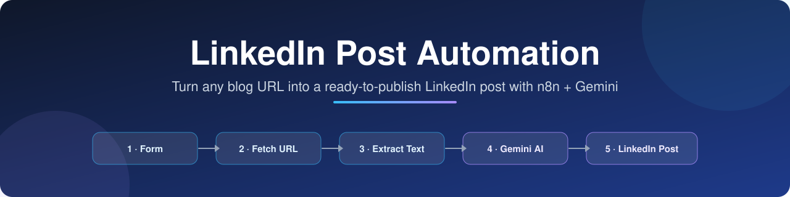
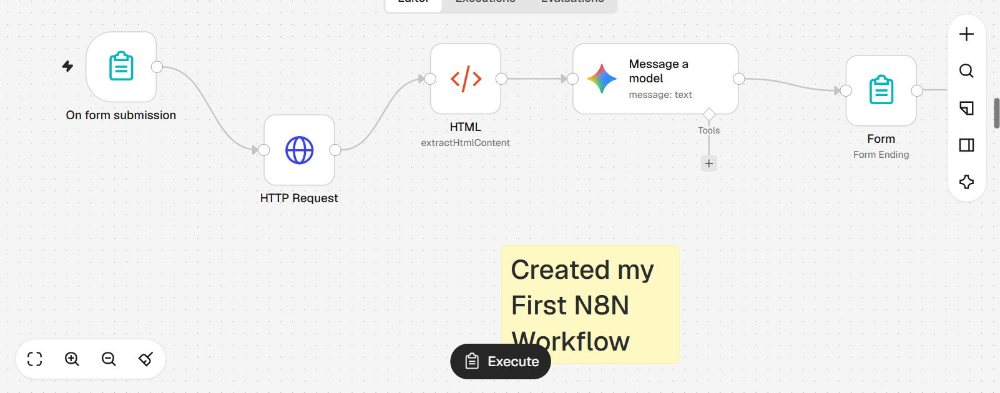
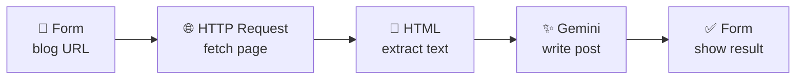

<div align="center">



<br>


**Paste a blog URL. Get a ready-to-publish LinkedIn post. No copy-pasting, no prompt-writing.**

[Features](#-features) · [How it works](#-how-it-works) · [Quick start](#-quick-start) · [Roadmap](#-roadmap)

</div>

---

## 📖 Overview

This is my first **AI agentic workflow**. It takes the link to any blog article, reads the content, and uses **Google Gemini** to write an engaging LinkedIn post: hook, key insights, closing question and hashtags. Everything runs inside [n8n](https://n8n.io), a low-code automation platform.

<div align="center">
  
  <br><sub>The complete workflow on the n8n canvas</sub>
</div>

## ✨ Features

| | Feature | Details |
|---|---|---|
| 📝 | **One-field form** | Just enter a blog URL, nothing else |
| 🌐 | **Auto content fetch** | Downloads the page and extracts the article text |
| 🤖 | **AI-written post** | Gemini creates a hook, short paragraphs, a question and 3-5 hashtags |
| 🛡️ | **Hallucination guard** | Prompt explicitly says *"Do not invent facts"* |
| ⚡ | **Instant result** | Post appears on the form's completion page |

## ⚙️ How it works



| Step | n8n node | Purpose |
|:---:|---|---|
| 1 | `On form submission` | Collects the blog URL |
| 2 | `HTTP Request` | Fetches the page HTML |
| 3 | `HTML` | Extracts the text into `article_text` |
| 4 | `Message a model` | Sends the article + prompt to Gemini |
| 5 | `Form` | Displays the generated LinkedIn post |

> Node-by-node details and the full prompt: [docs/how-it-works.md](docs/how-it-works.md)

## 🚀 Quick start

### Prerequisites

- **n8n**: self-hosted (`npx n8n` or Docker) or n8n Cloud
- **Gemini API key**: free from [Google AI Studio](https://aistudio.google.com/apikey)

### Installation

```bash
# 1. Clone the repo
git clone https://github.com/Rohit-coder-py/linkedin-post-automation.git
cd linkedin-post-automation

# 2. Start n8n
npx n8n
```

Then in the n8n editor at <http://localhost:5678>:

1. **Import** `workflows/linkedin-post-automation.json` (Workflows → Import from File)
2. Open the **Message a model** node → create a **Google Gemini (PaLM) API** credential with your key
3. Click **Execute workflow**, open the form, paste a blog link and submit

### Example

| Input | Output |
|---|---|
| `https://example.com/blog/ai-agents` | A LinkedIn post with a hook, key insights, a closing question and 3-5 hashtags |

## 📁 Project structure

```
linkedin-post-automation/
├── assets/                              # banner and screenshots
│   ├── banner.svg
│   └── workflow-overview.png
├── docs/
│   └── how-it-works.md                  # node-by-node explanation
├── workflows/
│   └── linkedin-post-automation.json    # importable n8n workflow
├── .github/workflows/validate.yml       # CI: JSON + secret check
├── .env.example
├── .gitignore
├── LICENSE
└── README.md
```

## 🔒 Security

The exported workflow contains **no API keys**. Your Gemini key stays inside your own n8n credentials. A GitHub Action also scans every push for accidentally committed secrets.

## 🗺️ Roadmap

- [ ] Extract only the article content (`article` / `main`) instead of the whole `body`
- [ ] Tone selector on the form (professional, casual, storytelling)
- [ ] Review step, then auto-post through the LinkedIn API
- [ ] Error handling for broken URLs and empty pages
- [ ] Generate multiple post variations

## 📄 License

Released under the [MIT License](LICENSE).

## 👤 Author

**Harsh**: built as my first AI automation project. If this helped you, consider giving the repo a ⭐

