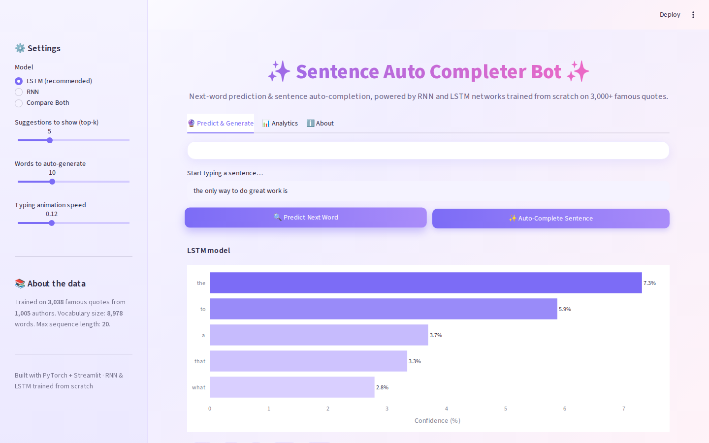
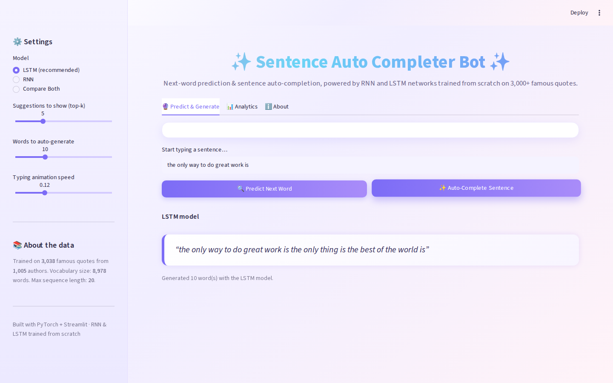
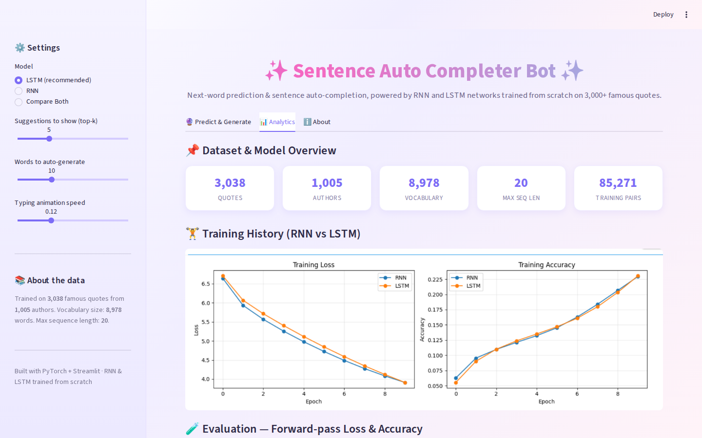
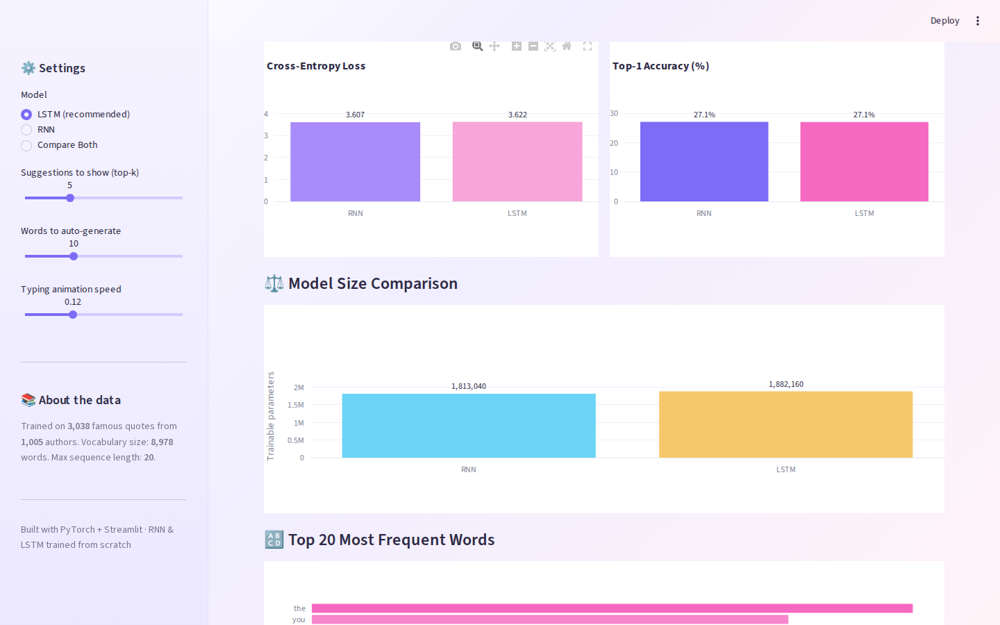

=<div align="center">

# ✨ Sentence Auto Completer Bot

**Next-word prediction and sentence auto-completion with RNN & LSTM networks built from scratch in PyTorch, served through an interactive Streamlit app.**

[](https://sentence-auto-completer-bot-rnn-pytorch.streamlit.app/)


### 🔗 [**Try the live app → sentence-auto-completer-bot-rnn-pytorch.streamlit.app**](https://sentence-auto-completer-bot-rnn-pytorch.streamlit.app/)


</div>

---

## 📖 Overview

Type the start of a sentence and the bot predicts what word comes next — or keeps going and finishes the whole thought. The models are trained on **3,038 famous quotes**, so the output reads like a (very small) quote generator.

Both a **vanilla RNN** and an **LSTM** are implemented and trained from scratch in PyTorch (no pretrained weights, no Hugging Face). The Streamlit app lets you pick either model, or compare them side by side on the same input.

## 🔮 Features

- **Next-word prediction** — top-k most likely next words with confidence bars (k adjustable, 3–10).
- **Sentence auto-completion** — generates up to 30 words with a live "typing" animation, shown as a quote card.
- **RNN vs LSTM** — use either model or **Compare Both** side by side.
- **Analytics dashboard** — dataset stats, training curves, loss/accuracy/parameter comparison, top words, Zipf's law, quote-length distribution and top authors (interactive Plotly charts).
- **CPU-only inference** — no GPU needed; models and data are cached so the app stays fast.

## 🖼️ Screenshots

| Predict | Generate |
|---|---|
|  |  |

| Analytics overview | Evaluation |
|---|---|
|  |  |

More in [`preview/`](preview/) (home, charts, about tab, and a full demo video).

---

## 🧠 How It Works

```
Raw quote ──► lowercase + strip punctuation ──► words → integer ids ──► (words so far → next word) pairs
                                                                              │
          predicted word ◄── softmax / argmax ◄── Linear ◄── RNN / LSTM ◄── Embedding ◄── pre-padded to max_len
```

1. **Cleaning** — lowercase and remove punctuation.
2. **Vocabulary** — hand-built with `collections.Counter` (PyTorch has no Keras-style `Tokenizer`). Index `0` is reserved for padding. The final vocabulary has **8,978 words**; the embedding table is sized for 10,000.
3. **Training pairs** — every quote is expanded into growing prefixes, e.g. `[the] → world`, `[the, world] → is`, … giving **85,271** `(input, next word)` examples.
4. **Padding** — sequences are **pre-padded** with zeros to `max_len = 745` (the longest prefix).
5. **Model** — `Embedding(10000, 50) → RNN/LSTM(128) → Linear(128 → 10000)`; only the last time step feeds the output layer.
6. **Training** — `CrossEntropyLoss` on raw class indices (no one-hot needed), Adam optimizer (`lr = 1e-3`), batch size 64, custom PyTorch training loop with `Dataset`/`DataLoader`.
7. **Generation** — greedy decoding: predict a word, append it, feed the longer text back in, repeat.

### Model summary

| Model | Architecture | Parameters |
|---|---|---|
| RNN  | `Embedding(10000, 50) → RNN(128) → Linear(10000)`  | 1,813,040 |
| LSTM | `Embedding(10000, 50) → LSTM(128) → Linear(10000)` | 1,882,160 |

### Results

Forward-pass evaluation over all 85,271 next-word examples (notebook, Section 19):

| Model | Cross-entropy loss | Top-1 accuracy |
|---|---|---|
| RNN  | 3.615 | 27.2% |
| LSTM | 3.661 | 26.4% |

<p align="center">
  
</p>

> **Honest notes on these numbers**
> - The evaluation set is the same data the models were trained on (a small, 3K-quote corpus), so these figures describe how well the models fit the quotes — **not** generalisation to unseen text. There is no held-out split.
> - On this dataset the plain RNN and the LSTM end up almost level (the RNN is marginally ahead). Both are small models trained on little data, so they often produce repetitive output — e.g. *"life is what happens to be a few times in the…"*. That is expected behaviour for a from-scratch next-word model at this scale.
> - Top-1 accuracy for next-word prediction over a ~9K-word vocabulary is naturally low; the top-k suggestions in the app are the more useful signal.

---

## 🚀 Run Locally

```bash
# 1. Clone and enter the project
git clone <your-repo-url>
cd "Sentence Auto Completer Bot"

# 2. (Recommended) create a virtual environment
python -m venv venv
source venv/bin/activate        # Windows: venv\Scripts\activate

# 3. Install dependencies
pip install -r requirements.txt

# 4. Launch the app
streamlit run app.py
```

The app opens at **http://localhost:8501**. Trained weights are included in `models/`, so nothing needs to be trained to use the app.

### Retraining (optional)

Open `notebook/quote_next_word_predictor.ipynb` and set `RETRAIN = True` in the training section. The notebook uses paths like `data/...` and `models/...`, so run it with the **project root** as the working directory (or adjust the paths). Training on CPU is slow because of the 10,000-way output layer.

---

## 🗂️ Project Structure

```
Sentence Auto Completer Bot/
├── app.py                      # Streamlit app (UI, inference, analytics)
├── requirements.txt
├── .streamlit/config.toml      # light theme + server settings
├── models/
│   ├── rnn_model.pth           # trained RNN weights
│   ├── lstm_model.pth          # trained LSTM weights
│   ├── vocab.pkl               # word_to_index / index_to_word
│   └── max_len.pkl             # padding length (745)
├── data/
│   └── qoute_dataset.csv       # 3,038 quotes · 1,005 authors
├── notebook/
│   └── quote_next_word_predictor.ipynb   # full pipeline: data → training → evaluation
├── graphs/                     # training curves & EDA charts
└── preview/                    # screenshots, GIF and demo video
```

## 📊 Dataset

- **3,038 quotes** from **1,005 authors** (CSV with `quote`, `Author` columns).
- Most-quoted authors: Cassandra Clare (92), J.K. Rowling (71), John Green (70), Albert Einstein (51), Mark Twain (48).

## 🛠️ Tech Stack

`Python` · `PyTorch` · `Streamlit` · `Plotly` · `Pandas` · `NumPy` · `Matplotlib / Seaborn` (notebook charts)

## 🔭 Possible Improvements

- Add a proper train/validation/test split and report held-out metrics and perplexity.
- Use sampling (temperature / top-k / nucleus) instead of greedy decoding to reduce repetition.
- Try stacked or bidirectional LSTM/GRU layers, dropout, and a larger corpus.
- Replace the word vocabulary with sub-word tokens to handle out-of-vocabulary words.

---

<div align="center">

Built with ❤️ using PyTorch and Streamlit · [**Live demo**](https://sentence-auto-completer-bot-rnn-pytorch.streamlit.app/)

</div>