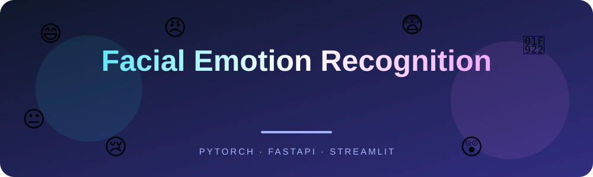
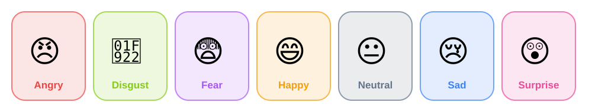
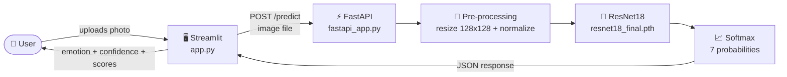
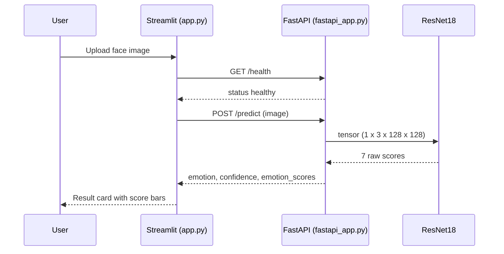

<div align="center">



<br>


[](https://facial-emotion-recognition-fastapi.streamlit.app/)

**An end-to-end deep learning project that reads a face photo and predicts the emotion, served through a FastAPI model server and a Streamlit web app.**

[Live Demo](https://facial-emotion-recognition-fastapi.streamlit.app/) •
[Overview](#-overview) •
[Architecture](#-architecture) •
[Dataset](#-dataset) •
[Models](#-models-and-results) •
[Quick Start](#-quick-start) •
[API](#-api-reference) •
[Roadmap](#-limitations-and-future-work)

</div>

---

## 🎯 Overview

This project classifies a face image into one of **7 emotions**. It covers the whole machine-learning life cycle: data cleaning, training a CNN from scratch, improving it with **transfer learning**, evaluating the models, and finally **deploying the best model as an API** with a clean web interface on top.

<div align="center">
  
</div>


<div align="center">
  <a href="https://facial-emotion-recognition-fastapi.streamlit.app/">
    
  </a>
</div>

### ✨ Highlights

| | Feature | Details |
|---|---|---|
| 🧠 | **Transfer learning** | ImageNet-pretrained ResNet18 fine-tuned in 2 phases |
| ⚖️ | **Imbalance handling** | Class weights + label smoothing (rare emotions like *disgust* are not ignored) |
| 🚀 | **Model as an API** | FastAPI server with `/predict`, `/health` and auto-generated `/docs` |
| 🖥️ | **Web interface** | Streamlit app with upload / camera input and a confidence bar for every emotion |
| 📊 | **Honest evaluation** | Separate validation set, unseen test set, per-class precision / recall / F1 |

---

## 🧭 Project Pipeline

<div align="center">
  
</div>

1. **Collect** – download FER2013 from Kaggle with `kagglehub`
2. **Clean** – scan every image and remove corrupted files
3. **Split** – 80 % train / 20 % validation from the train folder, the provided test folder is kept untouched
4. **Transform** – grayscale → 3 channels, resize to 128×128, ImageNet normalisation
5. **Augment** – flip, rotation, shift, zoom, brightness / contrast, random erasing (training images only)
6. **Train** – CNN from scratch first, then ResNet18 and MobileNetV2 with transfer learning
7. **Evaluate** – accuracy, precision, recall, F1-score and confusion matrix on the test set
8. **Deploy** – save the best checkpoint and serve it with FastAPI + Streamlit

---

## 🏗️ Architecture

The model lives in the **FastAPI backend**. The **Streamlit frontend** only sends the image and shows the answer, so the same API can later be used by a mobile app or a website.





---

## 🗂️ Dataset

The project uses the public **[FER2013](https://www.kaggle.com/datasets/msambare/fer2013)** dataset: **48 × 48 grayscale** face images in 7 classes.

| Split | Images | Used for |
|---|---:|---|
| Train (80 % of train folder) | 22,967 | learning |
| Validation (20 % of train folder) | 5,742 | choosing the best epoch |
| Test | 7,178 | final, one-time evaluation |

The data is **imbalanced**: *happy* has 7,215 training images while *disgust* has only 436. This is handled with class weights in the loss function (disgust gets roughly 3× importance).

<details>
<summary><b>📋 Images per emotion (train folder)</b></summary>

| Emotion | Train images | Test images |
|---|---:|---:|
| 😄 Happy | 7,215 | 1,774 |
| 😐 Neutral | 4,965 | 1,233 |
| 😢 Sad | 4,830 | 1,247 |
| 😨 Fear | 4,097 | 1,024 |
| 😠 Angry | 3,995 | 958 |
| 😲 Surprise | 3,171 | 831 |
| 🤢 Disgust | 436 | 111 |

</details>

---

## 🧪 Models and Results

Three models were trained and compared on the same unseen test set.

<div align="center">
  
</div>

| Model | Input | Parameters | Test accuracy |
|---|---|---:|---:|
| **ResNet18 (transfer learning)** 🏆 | 128 × 128 | ~11.2 M | **67.07 %** |
| MobileNetV2 (transfer learning) | 128 × 128 | ~2.2 M | 63.62 % |
| CNN from scratch | 48 × 48 | 1.57 M | 55.39 % |

> Transfer learning improved accuracy by about **+11.7 percentage points** over the CNN built from scratch.

### Model 1 – CNN from scratch
4 convolution blocks (32 → 64 → 128 → 256 filters, each with BatchNorm, ReLU and MaxPool) followed by `Linear(2304 → 512)`, Dropout 0.4 and `Linear(512 → 7)`. Adam optimizer (lr 0.001) with a learning-rate scheduler and early stopping. The model **overfitted** (train accuracy ≈ 84 % vs validation ≈ 59 %), so training stopped early at epoch 12.

### Model 2 – Transfer learning (final model)
| Setting | Value |
|---|---|
| New last layer | `Dropout(0.4)` → `Linear(512 → 7)` |
| Phase 1 | 5 epochs, only the new layer is trained (lr `1e-3`) |
| Phase 2 | up to 15 epochs, whole network fine-tuned (lr `1e-4`), early stopping patience 5 |
| Loss | CrossEntropy with class weights and label smoothing 0.1 |
| Extras | batch size 64, mixed-precision on GPU, 128 × 128 images |

### Per-emotion performance (ResNet18)

<div align="center">
  
</div>

<details>
<summary><b>📋 Full classification report</b></summary>

| Emotion | Precision | Recall | F1-score | Support |
|---|---:|---:|---:|---:|
| angry | 0.570 | 0.619 | 0.594 | 958 |
| disgust | 0.636 | 0.631 | 0.633 | 111 |
| fear | 0.542 | 0.452 | 0.493 | 1024 |
| happy | 0.864 | 0.874 | 0.869 | 1774 |
| neutral | 0.595 | 0.695 | 0.641 | 1233 |
| sad | 0.588 | 0.482 | 0.530 | 1247 |
| surprise | 0.741 | 0.817 | 0.777 | 831 |
| **accuracy** | | | **0.671** | 7178 |
| macro avg | 0.648 | 0.653 | 0.648 | 7178 |
| weighted avg | 0.667 | 0.671 | 0.666 | 7178 |

</details>

**What we learn:** *happy* and *surprise* are easy (clear smile or open mouth), while *fear* and *sad* are hardest because they look like other emotions.

---

## 🚀 Quick Start

### 1. Clone and install

```bash
git clone https://github.com/<your-username>/<your-repo>.git
cd "Facial Emotion Recogination"

pip install streamlit fastapi uvicorn python-multipart requests torch torchvision pillow
```

### 2. Add the trained model

Place these two files inside the `models/` folder:

```
models/
├── resnet18_final.pth     # checkpoint created by the Transfer Learning notebook
└── class_names.json       # ["angry","disgust","fear","happy","neutral","sad","surprise"]
```

### 3. Start the backend (terminal 1)

```bash
uvicorn fastapi_app:app --port 8000
```

### 4. Start the frontend (terminal 2)

```bash
streamlit run app.py
```

Open **http://localhost:8501**, upload a face photo and click **Predict Emotion**.
Interactive API docs are available at **http://127.0.0.1:8000/docs**.

---

## 🔌 API Reference

| Method | Endpoint | Description |
|---|---|---|
| `GET` | `/` | API info, model name and class list |
| `GET` | `/health` | Health check (status, model loaded, device) |
| `POST` | `/predict` | Upload an image, get the predicted emotion |

**Example request**

```bash
curl -X POST "http://127.0.0.1:8000/predict" -F "file=@face.jpg"
```

**Example response** (values are illustrative)

```json
{
  "filename": "face.jpg",
  "predicted_emotion": "happy",
  "confidence": 91.37,
  "emotion_scores": {
    "angry": 1.2,
    "disgust": 0.4,
    "fear": 1.9,
    "happy": 91.37,
    "neutral": 3.1,
    "sad": 1.2,
    "surprise": 0.83
  }
}
```

---

## 📁 Project Structure

```
Facial Emotion Recogination/
├── app.py                  # Streamlit frontend (sends image to the API)
├── fastapi_app.py          # FastAPI backend (loads ResNet18, serves /predict)
├── logo.png                # Project logo
├── data/
│   └── data.py             # Dataset link (FER2013 on Kaggle)
├── models/                 # resnet18_final.pth + class_names.json
├── assets/                 # Animated SVGs used in this README
└── notebook/
    ├── Facial_Emotion_Recognition.ipynb            # Model 1: CNN from scratch
    ├── Facial_Emotion_Transfer_Learning_(1).ipynb  # Model 2: ResNet18 / MobileNetV2
    └── Model Inference.ipynb                       # Loading the checkpoint + test prediction
```

---

## 🛠️ Tech Stack

<div align="center">


</div>

---

## ⚠️ Limitations and Future Work

- FER2013 labels are noisy and the photos are low quality, so accuracy has a natural ceiling (even humans only reach about 65 % on it).
- The model reads **facial expression**, not real inner feelings.
- It works best with **one clear, front-facing face**. Side views, sunglasses and dark photos reduce accuracy.

**Ideas for next steps**
- [ ] Automatic face detection and cropping before prediction
- [ ] Real-time webcam video prediction
- [ ] Try bigger backbones (EfficientNet) and test-time augmentation
- [ ] Train on more diverse data such as AffectNet
- [ ] Dockerize the API and Streamlit app

---

## 🙏 Acknowledgements

- Dataset: [FER2013 on Kaggle](https://www.kaggle.com/datasets/msambare/fer2013)
- Pretrained weights: [torchvision](https://pytorch.org/vision/stable/models.html) (ImageNet)

<div align="center">
  <br>
  
  <br>
  <sub>If you like this project, give it a ⭐</sub>
</div>
