<div align="center">



<br>


<!-- ============================================================
     DEMO LINKS: replace the two REPLACE-WITH-... URLs below.
     Tip: search this file for "REPLACE-WITH" to find every spot.
     ============================================================ -->
[](https://REPLACE-WITH-YOUR-LIVE-LINK)
&nbsp;
[](https://REPLACE-WITH-YOUR-DOCKER-HUB-LINK)

</div>


<details>
<summary><b>Table of contents</b></summary>

1. [What is Aether?](#what-is-aether)
2. [Demo links](#demo-links)
3. [Preview](#preview)
4. [Features](#features)
5. [How it works](#how-it-works)
6. [Tech stack](#tech-stack)
7. [Quick start](#quick-start)
8. [Configuration](#configuration)
9. [Try it: example questions](#try-it-example-questions)
10. [Project structure](#project-structure)
11. [Testing and results](#testing-and-results)
12. [Documentation](#documentation)
13. [Limitations and privacy](#limitations-and-privacy)
14. [Roadmap](#roadmap)
15. [Project journey](#project-journey)
16. [Author](#author)

</details>

## What is Aether?

A normal chatbot is one model answering everything from memory. **Aether** splits the job between small specialists, the way a real office would:

- a **Planner** reads your question and decides what information is needed,
- a **Document Analyst** answers from *your own PDF* (RAG, with page numbers),
- a **Researcher** searches the *live web* for anything that is not in your file,
- a **Writer** turns the findings into one clean, well-structured answer.

The result is an answer grounded in **your documents** and **fresh sources**, not guesswork. You can watch the agents work in a live status panel, so nothing is a black box.

> Built as a hands-on AI Engineering capstone: multi-agent orchestration, retrieval-augmented generation, tool calling, a custom-themed Streamlit UI, Docker packaging and a 19-case manual evaluation.


## Demo links

| | Link | Notes |
|---|---|---|
| 🌐 **Live app** | [REPLACE-WITH-YOUR-LIVE-LINK](https://REPLACE-WITH-YOUR-LIVE-LINK) | Upload a PDF and ask away |
| 🐳 **Docker Hub** | [REPLACE-WITH-YOUR-DOCKER-HUB-LINK](https://REPLACE-WITH-YOUR-DOCKER-HUB-LINK) | `docker pull <your-username>/aether:latest` |
| 🎬 **Test recording** | [`docs/manual_testing.mp4`](docs/manual_testing.mp4) | 40 s walkthrough of the manual test run |

<!-- Once the Docker image is pushed, the run command in "Quick start" can use it directly. -->


## Preview

<div align="center">

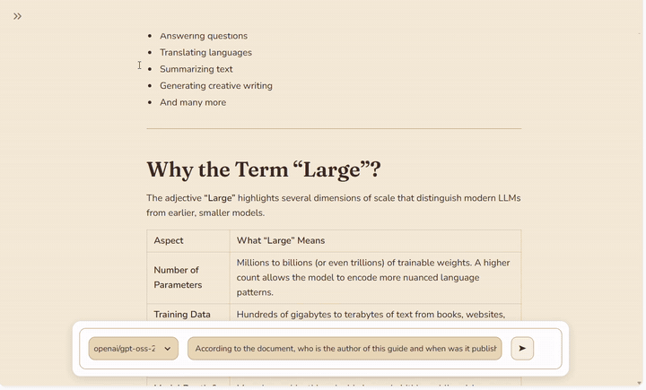

<sub>The manual test run: PDF questions, live web research, combined questions and "not in the document" traps.</sub>

</div>

<br>

<table>
  <tr>
    <td width="50%" align="center">
      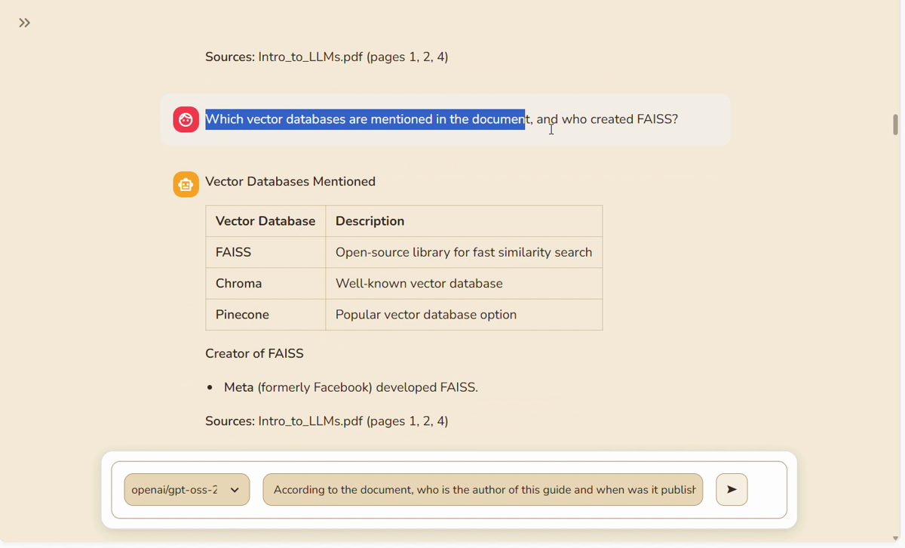
      <br><sub><b>Grounded in your PDF</b>: structured answer with page-cited sources</sub>
    </td>
    <td width="50%" align="center">
      
      <br><sub><b>Live web research</b>: fresh data with source links</sub>
    </td>
  </tr>
  <tr>
    <td width="50%" align="center">
      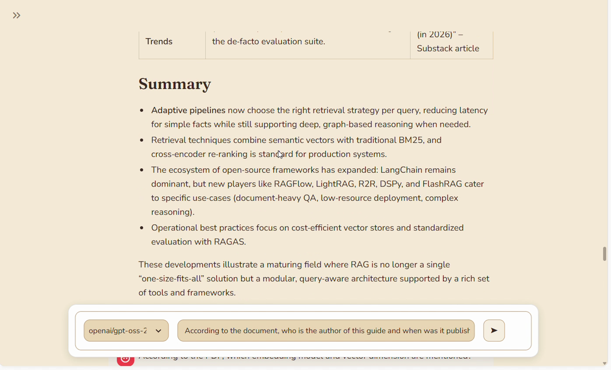
      <br><sub><b>PDF + web in one answer</b>: the Planner uses both tools</sub>
    </td>
    <td width="50%" align="center">
      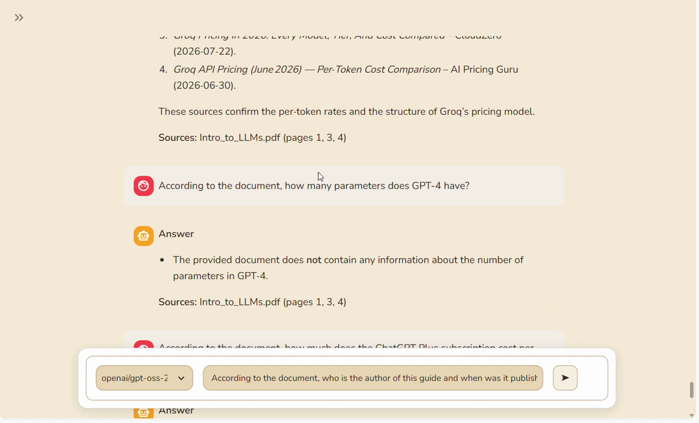
      <br><sub><b>Honest "not found"</b>: no invented facts</sub>
    </td>
  </tr>
</table>

<details>
<summary><b>More screens</b> (replace the placeholders with your own screenshots)</summary>

<br>

| Chat home | PDF upload |
|:---:|:---:|
| 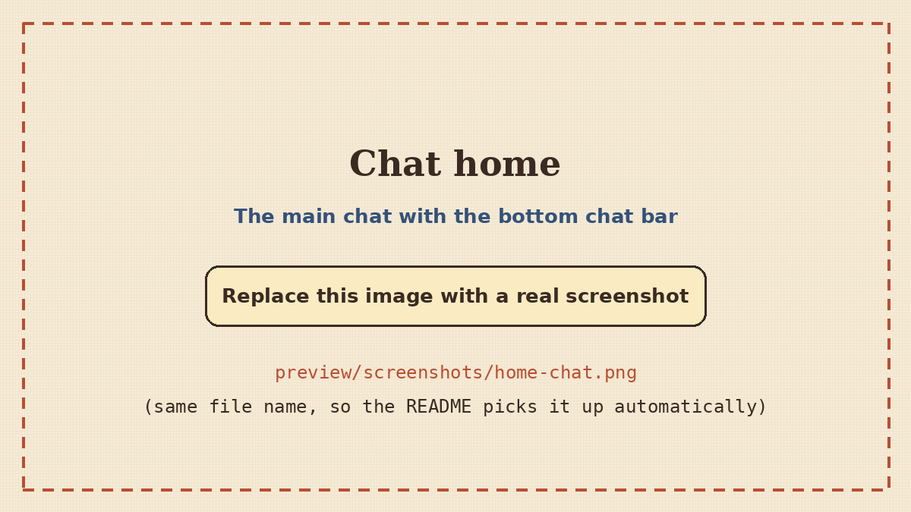 | 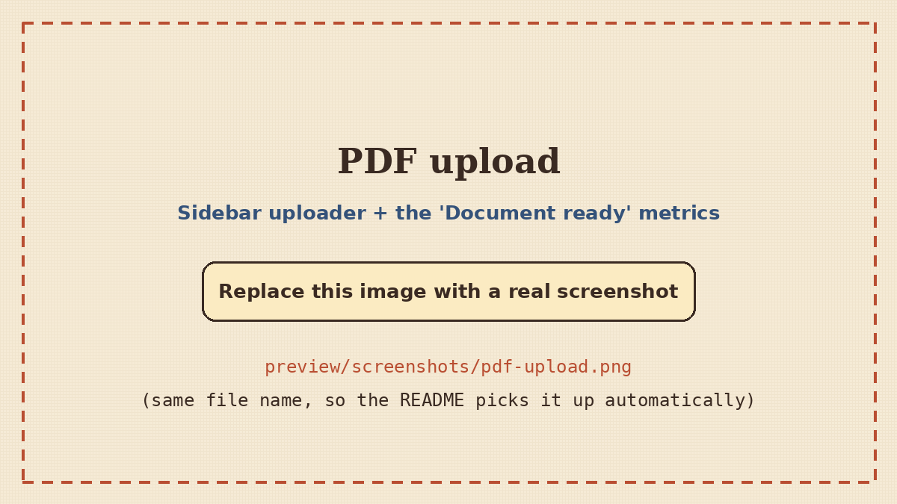 |

| Agents at work | Recent chats | About page |
|:---:|:---:|:---:|
| 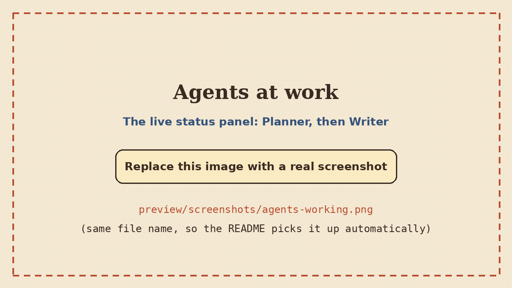 | 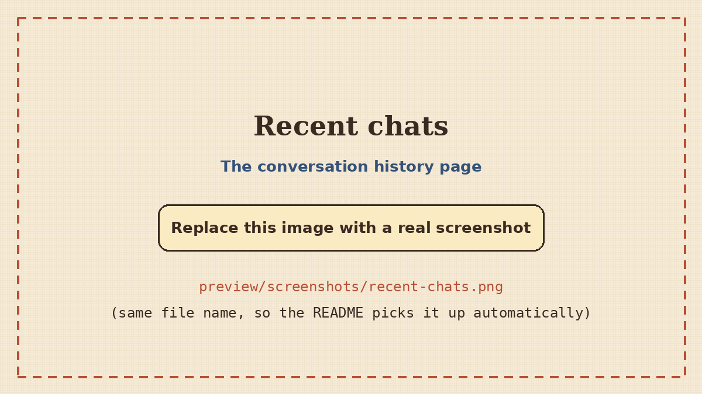 | 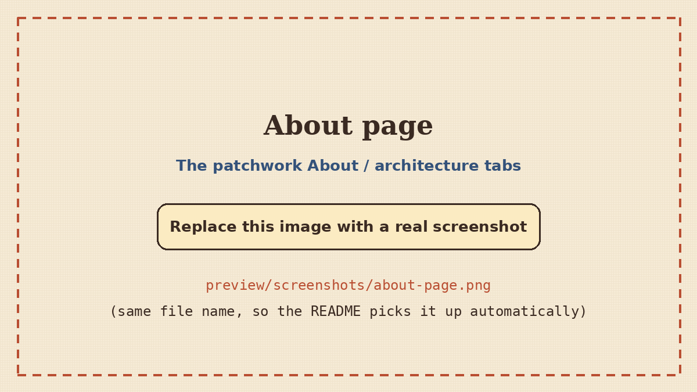 |

</details>

> Want to add your own images or SVGs? Drop them into [`preview/`](preview/) and see [`preview/README.md`](preview/README.md) for naming and sizing tips.


## Features

| | Feature | What it does |
|---|---|---|
| 📄 | **Talk to your PDF** | Upload a text-based PDF and ask anything. Answers use only the document and cite page numbers. |
| 🌐 | **Live web research** | Tavily advanced search returns four sources with titles, links and summaries. |
| 🧵 | **Both in one question** | The Planner can call the document tool, the web tool, or both, then merge the results. |
| ✨ | **Answers that look finished** | A dedicated Writer agent adds headings, bullets and tables when they help. |
| 🛡️ | **Fewer hallucinations** | Strict document prompt, low temperature (0.2), and a clear "not found" response. 0 of 3 trap questions were hallucinated in testing. |
| 👀 | **Visible reasoning** | A live status panel shows *Using Planner Agent... Using Writer Agent...* |
| 🗂️ | **Chat history** | Every conversation is titled from its first message and listed under **Recent Chats**. |
| 🧰 | **Resilient tool calls** | Middleware turns tool errors into messages so the agent can recover instead of crashing. |
| 🎨 | **Patchwork Stitched theme** | A custom hand-sewn look: fabric background, stitched borders, patch-style cards. |
| 🐳 | **Docker ready** | CPU-only PyTorch, embedding model baked into the image, non-root user, health check. |


## How it works

<div align="center">
</div>

1. **Planner Agent** (LangChain `create_agent`) reads the question and picks the tools. The document tool is only attached when a PDF is loaded, so the model can never call a tool that has nothing to read.
2. **Document Analyst** runs retrieval over the FAISS index and answers with a strict "context only" prompt.
3. **Researcher** calls Tavily and returns titles, URLs and trimmed summaries.
4. **Writer Agent** receives the question plus the Planner output and formats the final answer, adding no new facts.

### The RAG pipeline


A signature of `file name + size` decides when to re-index, so ordinary Streamlit reruns stay fast. Nothing is written to disk: the vectors live in memory and disappear when the PDF is removed.

> Deep dive with Mermaid diagrams: [`docs/ARCHITECTURE.md`](docs/ARCHITECTURE.md)


## Tech stack

| Layer | Technology |
|---|---|
| **UI** | Streamlit (multipage), custom CSS theme in `patchwork.py` and `.streamlit/config.toml` |
| **LLM** | `openai/gpt-oss-20b` on **Groq** through `langchain-groq` (temperature 0.2) |
| **Agents** | LangChain 1.x: `create_agent`, `@tool`, `@wrap_tool_call` middleware, `ChatPromptTemplate` |
| **RAG** | `pypdf` → `RecursiveCharacterTextSplitter` (1000 / 150) → `all-MiniLM-L6-v2` (384-dim) → **FAISS** (top-4) |
| **Web research** | **Tavily** search API (`advanced` depth, 4 results) |
| **Packaging** | Docker (`python:3.11-slim`), `python-dotenv` for configuration |


## Quick start

You need **Python 3.10+** (3.11 recommended) and two free API keys:
[Groq](https://console.groq.com/keys) and [Tavily](https://app.tavily.com/).

### Option A: run locally

```bash
# 1. Get the code (change the URL if your repository name is different)
git clone https://github.com/Rohit-coder-py/Aether.git
cd Aether

# 2. Create and activate a virtual environment
python -m venv .venv
# Windows:      .venv\Scripts\activate
# macOS/Linux:  source .venv/bin/activate

# 3. Install the dependencies
pip install -r requirements.txt

# 4. Add your API keys
cp env.example .env        # Windows (cmd): copy env.example .env
# then open .env and paste your GROQ_API_KEY and TAVILY_API_KEY

# 5. Start the app
streamlit run app.py
```

Open <http://localhost:8501>. The first run downloads the embedding model (about 90 MB), so give it a minute.

### Option B: run with Docker

```bash
docker build -t aether .
docker run --env-file .env -p 8501:8501 aether
```

Or, once the image is on Docker Hub:

```bash
docker run --env-file .env -p 8501:8501 <your-username>/aether:latest
```

API keys are **never baked into the image**; they are passed at run time. More detail, troubleshooting and deployment notes: [`docs/SETUP_AND_DEPLOYMENT.md`](docs/SETUP_AND_DEPLOYMENT.md).


## Configuration

| Variable | Required | Used for |
|---|:---:|---|
| `GROQ_API_KEY` | ✅ | Planner, Document Analyst and Writer (LLM calls) |
| `TAVILY_API_KEY` | ✅ | The live web Researcher agent |

Tunable settings live at the top of [`app.py`](app.py):

| Setting | Value | Meaning |
|---|---|---|
| `model_name` | `openai/gpt-oss-20b` | LLM served by Groq |
| `temperature` | `0.2` | Low = stable, factual wording |
| `chunk_size` / `chunk_overlap` | `1000` / `150` | How the PDF is split |
| `RETRIEVAL_K` | `4` | Passages retrieved per question |
| `max_results` | `4` | Web sources per research call |


## Try it: example questions

Upload [`sample_data/Intro_to_LLMs.pdf`](sample_data/Intro_to_LLMs.pdf) and try:

| Type | Question |
|---|---|
| 📄 PDF only | *What is an embedding according to the document, and how many numbers does the all-MiniLM-L6-v2 model produce in a vector?* |
| 🌐 Web only | *What is the latest stable version of Python?* |
| 🧵 PDF + web | *According to the PDF, what is RAG? Then search the web for recent news about new RAG techniques.* |
| 🚫 Not in the PDF | *According to the document, how much does the ChatGPT Plus subscription cost per month?* (Aether should say it cannot find it.) |

All 19 evaluation questions: [`docs/demo_questions.md`](docs/demo_questions.md).


## Project structure

```text
Aether/
├── app.py                  # Main chat page: agents, tools, RAG, session state
├── pages/
│   └── 1_About.py          # About page: user view + technical deep dive
├── patchwork.py            # "Patchwork Stitched" CSS + HTML helpers
├── .streamlit/config.toml  # Theme colours and fonts
├── assets/logo.png         # Logo
├── sample_data/            # Intro_to_LLMs.pdf (4-page test document)
├── docs/                   # Capstone documentation (see below)
├── preview/                # README images, animated SVGs, GIF, screenshots
├── pseudo_codes/           # Earlier learning versions that led to Aether
├── requirements.txt        # Python dependencies
├── env.example             # Template for your API keys
├── Dockerfile              # Container build
├── .dockerignore
└── .gitignore
```


## Testing and results

Aether v1.0 was evaluated end to end through the real Streamlit UI with **19 manual test cases**. Every answer was checked against the actual PDF text and, for current-events questions, against independent web searches.

<div align="center">
</div>

| Metric | Result |
|---|---|
| Tests passed | **18 / 19 (94.7%)** |
| Correct tool selection | 18 / 19 |
| Correct page cited (PDF tests) | 7 / 8 |
| Hallucinations on missing information | **0 / 3** |

**Honest failure analysis**: the single failure (Test 09) was a current-events question that the Planner answered from stale memory instead of searching. The root cause and two concrete fixes are documented in [`docs/test_results.md`](docs/test_results.md) and turned into a plan in [`docs/ROADMAP.md`](docs/ROADMAP.md).


## Documentation

| Document | What is inside |
|---|---|
| [`docs/PROJECT_REPORT.md`](docs/PROJECT_REPORT.md) | Full capstone report: problem, objectives, design, implementation, testing, conclusion |
| [`docs/ARCHITECTURE.md`](docs/ARCHITECTURE.md) | Mermaid diagrams, component table, data flow, design decisions |
| [`docs/SETUP_AND_DEPLOYMENT.md`](docs/SETUP_AND_DEPLOYMENT.md) | Local and Docker setup, pushing to Docker Hub, deployment options, troubleshooting |
| [`docs/test_results.md`](docs/test_results.md) | The 19-case evaluation report with failure analysis |
| [`docs/demo_questions.md`](docs/demo_questions.md) | The exact questions used in testing |
| [`docs/ROADMAP.md`](docs/ROADMAP.md) | Known issues with ready-to-use fixes, and the V2 backlog |
| [`docs/CAPSTONE_CHECKLIST.md`](docs/CAPSTONE_CHECKLIST.md) | Submission checklist, rubric mapping, presentation outline, viva questions |


## Limitations and privacy

- **Text-based PDFs only.** Scanned images need OCR first.
- **One PDF at a time.** Chats live in the browser session, so a refresh starts clean.
- **No follow-up memory yet.** The Planner does not receive earlier chat messages.
- **Free-tier rate limits.** Groq's tokens-per-minute limit can return a `429` on rapid back-to-back questions (the app shows a clean error).
- **Privacy.** The PDF is processed in memory, but the retrieved passages and your web queries are sent to the Groq and Tavily APIs. Avoid highly confidential files.


## Roadmap

| Priority | Item |
|:---:|---|
| 🔴 V1.1 | Force `researcher_agent` for time-sensitive questions (fixes Test 09) |
| 🔴 V1.1 | Writer always ends with a **Sources** line (fixes Test 01) |
| 🟡 V2 | Conversation memory for the Planner, retry with backoff on `429`, persistent chat history |
| 🟢 Later | Multi-PDF support, OCR for scans, automated RAG evaluation (RAGAS / LangSmith), CI with GitHub Actions |

Full list with code snippets: [`docs/ROADMAP.md`](docs/ROADMAP.md).

## Project journey

Aether did not appear in one step. The [`pseudo_codes/`](pseudo_codes/) folder keeps the practice versions it grew from:

`simple streamlit chatbot` → `session_state_chatbot` → `Document_Brain` (RAG over a PDF) → `Multi-Agent-System` → **Aether**

## Author

**Rohit Jha** · BCA student, building towards an AI/ML career

[](https://github.com/Rohit-coder-py)
[](https://linkedin.com/in/rohit-jha-ai)

<div align="center">
<br>

<br>
<sub>Stitched together from many small specialists.</sub>
</div>
