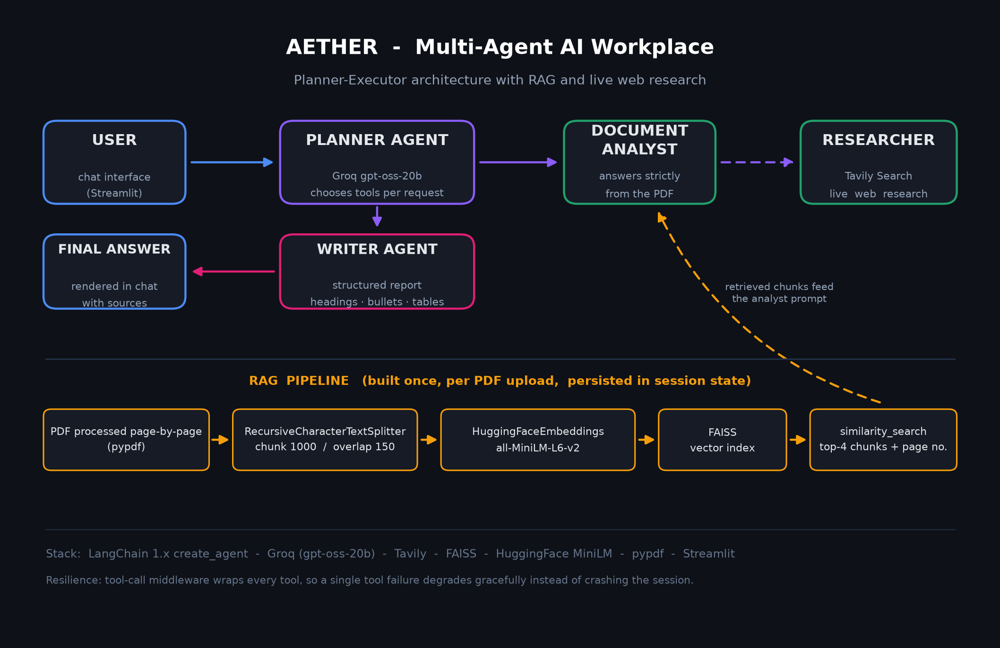

<div align="center">


# AETHER — Your Multi-Agent AI Workplace

**One planner. Three specialists. One structured, source-cited answer.**

*LangChain 1.x · Groq (gpt-oss-20b) · FAISS RAG · Tavily live search · Streamlit*


</div>

---

> **Aether** is a multi-agent research assistant: a **Planner agent** routes every
> request to specialist agents — a **Document Analyst** that answers *strictly*
> from your uploaded PDF with page citations (RAG: MiniLM embeddings → FAISS),
> and a **Researcher** that pulls live web evidence via Tavily — then a **Writer
> agent** fuses everything into a structured report. It ships with an
> **evaluation harness** that measures retrieval quality, groundedness,
> hallucination-refusal and planner routing with real numbers.

<!-- 📽️ TODO: record a 30s demo with ScreenToGif or OBS → assets/demo.gif, then embed:

-->

## Why this isn't another "chat with your PDF" demo

Most RAG demos stop at retrieval and say "it works." Aether was built like a
product and **measured like an experiment** — the `evaluation/` folder runs a
golden-QA benchmark against the bundled sample document and produces a
metrics report anyone can reproduce:



## 📊 Evaluation results (measured, reproducible)

Full methodology in [`docs/architecture.md`](docs/architecture.md) and
[`evaluation/RESULTS.md`](evaluation/RESULTS.md) · harness: `python evaluation/evaluate.py`

<!-- ✍️ Paste the table below as an image in your resume/LP post -->

| Metric | Value | What it means |
|---|:---:|---|
| Retrieval **Hit@1** | **64.3%** | answer fully inside the single best chunk |
| Retrieval **Hit@4** | **100%** | answer always inside the 4 chunks shipped to the analyst |
| MRR | **0.786** | mean reciprocal rank over 14 golden questions |
| **Grounded accuracy** (LLM-as-judge) | **93.3%** | every claim in the answer is supported by retrieved context (strict-rubric verdicts) |
| **Gatekeeping / refusal** | **100%** | out-of-document questions are *refused*, never hallucinated |
| **Planner routing accuracy** | **100%** | the planner calls exactly the right tool set per request |

*(Corpus: the bundled 6-page sample handbook → 11 chunks; 14 answerable + 1 must-refuse golden QAs; judged with the same chat model `openai/gpt-oss-20b` at temperature 0. Small-corpus Hit@4 saturates by construction — the interesting signal is the strict judge + refusal behaviour.)*

## ✨ Features

- 🧠 **Planner-Executor architecture** — one LLM decides *which* specialists a
  request needs (document? web? both? neither?), instead of a fixed chain.
- 📄 **Document Analyst with groundedness rules** — answers only from the
  uploaded PDF, cites page numbers inherited from chunk metadata, and
  *refuses* questions the document can't answer.
- 🌐 **Researcher** — live web evidence via Tavily (`advanced` search depth).
- ✍️ **Writer agent** — converts raw findings into headings, bullets and
  tables; format is consistent regardless of which tools ran.
- 🛡️ **Fault-tolerant tool middleware** — every tool call is wrapped, so one
  failing API degrades the answer instead of crashing the session.
- 📈 **Session metrics panel** — pages / chunks / stored vectors, live.
- 🧪 **Evaluation harness + tests + CI** — golden-QA retrieval metrics,
  LLM-as-judge groundedness, refusal checks, planner routing (stubbed, no
  quota spent), pytest suite, GitHub Actions workflow.

## 🚀 Quickstart (2 minutes)

```bash
# 1. clone
git clone https://github.com/YOUR_USERNAME/Aether.git
cd Aether

# 2. install
pip install -r requirements.txt

# 3. add your keys (Groq + Tavily free tiers are enough)
copy .env.example .env      # Windows    (macOS/Linux: cp .env.example .env)
#    → paste keys from https://console.groq.com/keys and https://app.tavily.com/

# 4. run
streamlit run app.py
```

No PDF handy? Upload `sample_data/Aether_Product_Handbook.pdf` — the bundled
test document. Try these prompts:

| Prompt | What it shows |
|---|---|
| *"What chunk size and overlap does the splitter use?"* | RAG + page citation |
| *"Who won the 2022 FIFA World Cup?"* | **refusal instead of hallucination** |
| *"Does the handbook cover middleware, and add current industry context on agent reliability?"* | both agents + structured report |

## 🧪 Run the evaluation & tests yourself

```bash
python evaluation/evaluate.py        # full: retrieval + LLM judge + routing
python evaluation/evaluate.py --fast # retrieval metrics only (no API cost)
pytest tests/ -v                     # 13 keyless tests, CI-friendly
```

## 📁 Project structure

```
Aether/
├── app.py                       # the whole product: UI, agents, RAG pipeline
├── about.py                     # Streamlit "About" page
├── assets/                      # logo + architecture diagram
├── docs/
│   ├── architecture.md          # deep-dive: components, design decisions, limits
│   └── showcase_guide.md        # (private) resume bullets, demo script, LinkedIn post
├── evaluation/
│   ├── evaluate.py              # golden-QA harness: hit@k, MRR, LLM-judge, routing
│   ├── results.json             # machine-readable results of the last run
│   └── RESULTS.md               # human-readable report (linked above)
├── sample_data/
│   └── Aether_Product_Handbook.pdf   # bundled doc so anyone can test instantly
├── tests/
│   ├── test_engineering_hygiene.py   # compiles everything, secret & manifest checks
│   └── test_evaluation_unit.py       # golden-QA integrity + retrieval behaviour
├── requirements.txt · requirements-dev.txt
├── .env.example · .gitignore · LICENSE (MIT)
└── .github/workflows/tests.yml       # CI: syntax check + keyless test suite
```

## 🗺️ Roadmap

- [ ] Streaming responses (token-by-token in chat)
- [ ] OCR support for scanned PDFs
- [ ] Multi-document workspace & comparison
- [ ] Persistent chat memory across sessions + PDF export of reports
- [ ] Plugin system: user-defined agent tools registered from a folder
- [ ] Chunk-size study: sweep 300/500/1000 × overlap and publish the metric row

## 🤝 Acknowledgements

Built with open tools: [LangChain](https://python.langchain.com) ·
[Groq](https://groq.com) · [Tavily](https://tavily.com) ·
[FAISS](https://github.com/facebookresearch/faiss) ·
[sentence-transformers](https://www.sbert.net) · [Streamlit](https://streamlit.io)

## 📄 License

[MIT](LICENSE) — free to use, fork and build upon.
