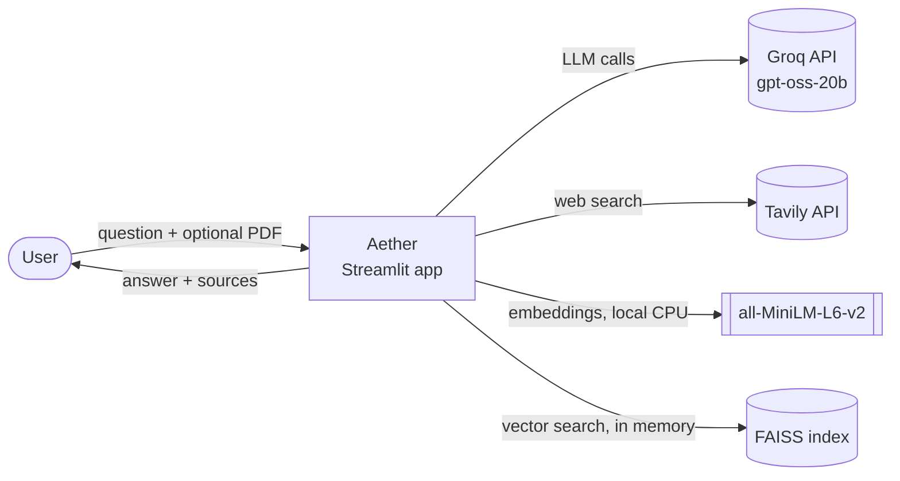
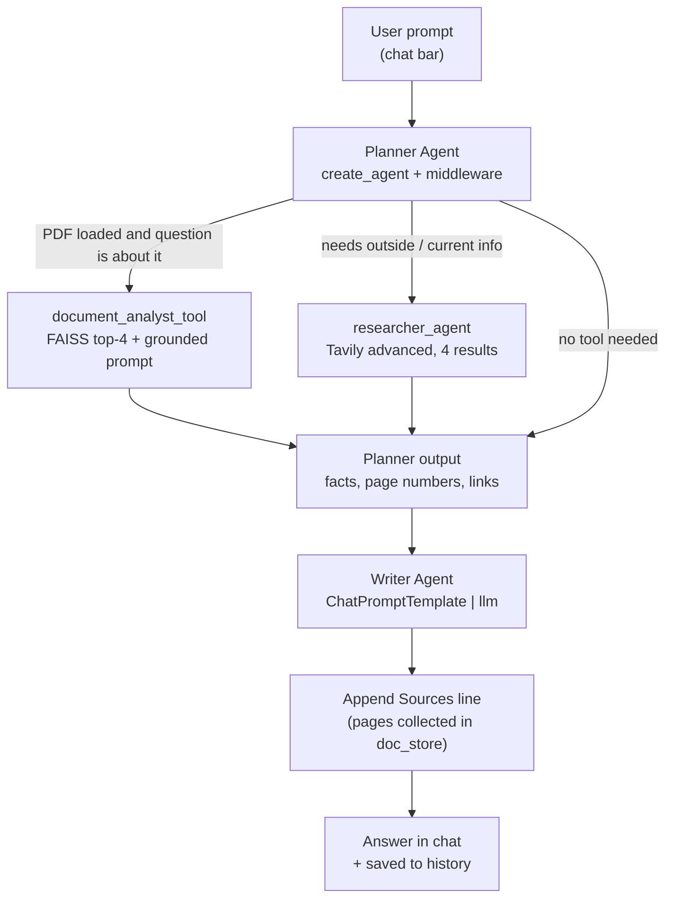
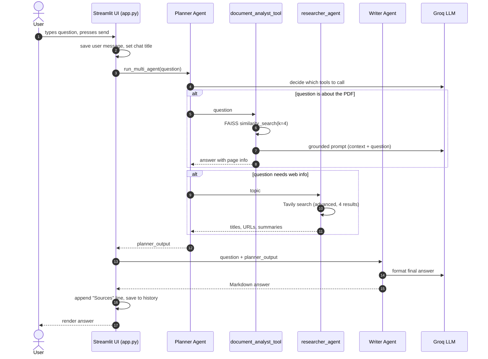
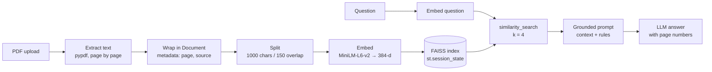
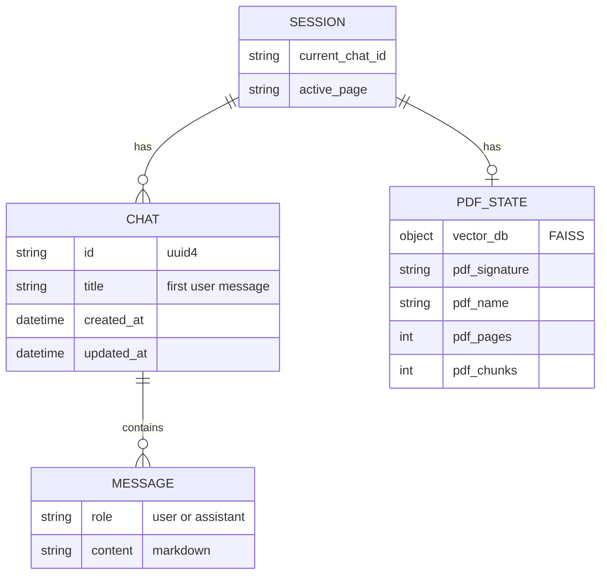

# Aether Architecture

This document explains how Aether is put together and why. For the user-facing story see the [README](../README.md); for the full capstone write-up see [`PROJECT_REPORT.md`](PROJECT_REPORT.md).

## 1. System context

Aether is a single Streamlit application that talks to two external APIs and one local model.

| Dependency | Runs where | Used for |
|---|---|---|
| Groq | Cloud | Planner, Document Analyst and Writer LLM calls |
| Tavily | Cloud | Live web search for the Researcher |
| `all-MiniLM-L6-v2` | Local (CPU) | Turning PDF chunks and questions into 384-dim vectors |
| FAISS | Local (memory) | Finding the chunks closest to a question |

## 2. Agent flow

Key points:

- The Planner is **rebuilt for every request** by `build_planner_agent(pdf_loaded)`. When no PDF is loaded it only receives `researcher_agent`, so it cannot call a tool that has nothing to read.
- Tools can be called **together** in one request (the Planner decides).
- The Writer has **no tools**. It receives only the question and the Planner output, and is told not to add facts.
- The **Sources** line is appended in code from the pages the tool actually retrieved, which is more reliable than asking the Writer to repeat them.

## 3. Sequence of one question

## 4. RAG pipeline

| Step | Library | Detail |
|---|---|---|
| Extract | `pypdf.PdfReader` | Pages with no text are skipped; if nothing is extractable the user is told the PDF may be scanned |
| Wrap | `langchain_core.documents.Document` | Metadata `page` and `source` enable page-numbered answers |
| Split | `RecursiveCharacterTextSplitter` | `chunk_size=1000`, `chunk_overlap=150` |
| Embed | `HuggingFaceEmbeddings` | Model loaded once with `st.cache_resource` |
| Index | `FAISS.from_documents` | Kept in `st.session_state.vector_db`; nothing is written to disk |
| Retrieve | `similarity_search(question, k=4)` | `RETRIEVAL_K` constant |
| Answer | `doc_prompt \| llm` | System prompt: use only the context, say so if it is missing, cite pages |

**Re-index rule.** A signature (`file name + size`) is stored. The PDF is only re-processed when the signature changes, so normal Streamlit reruns stay fast. Removing the PDF clears the index and the counters.

## 5. State model

All state lives in `st.session_state` (per browser session, in memory).

## 6. Components and code map

| Component | Where to look in `app.py` | Notes |
|---|---|---|
| LLM client | `llm = ChatGroq(...)` | One instance shared by Planner, Document Analyst and Writer |
| Chat state helpers | `create_new_chat()`, `get_current_chat()` | New chats get a `uuid4` id |
| Embedding loader | `get_embeddings()` | `@st.cache_resource` |
| PDF ingestion | Sidebar block with `st.file_uploader` | Signature check, spinner, error handling |
| History page | `if st.session_state.active_page == "history"` | Sorted by `updated_at`, then `st.stop()` |
| Chat bar | `st.container(key="chat_bar")` + CSS | Fixed to the bottom of the screen |
| Researcher | `researcher_agent()` | `@tool`, Tavily `advanced`, `max_results=4` |
| Document Analyst | `document_analyst_tool()` | `@tool`, reads `doc_store["vector_db"]` |
| Error middleware | `handle_tool_errors()` | `@wrap_tool_call` returns a `ToolMessage` |
| Planner | `build_planner_agent()` | `create_agent`, dynamic tool list and prompt |
| Writer | `writer_prompt` and `writer_agent` | Formatting only |
| Orchestrator | `run_multi_agent()` | Planner, then Writer, then Sources line |
| Submit handler | `if submitted and user_input.strip()` | Saves messages, shows `st.status` |

Other files: `pages/1_About.py` (About page; reads its numbers live from `app.py` so it never goes out of date), `patchwork.py` (theme CSS and `html()` helper), `.streamlit/config.toml` (colours and fonts).

## 7. Design decisions

| Decision | Alternatives considered | Why this choice |
|---|---|---|
| **Planner then Writer** (two stages) | One agent doing everything | Separation of concerns: each prompt stays short, focused and easy to debug |
| **Tools instead of one big prompt** | Stuffing the whole PDF into the prompt | Facts are fetched on demand; large PDFs fit; the model cannot silently ignore the document |
| **Dynamic tool list** | Always offer both tools | The model can never call a document tool when there is no document |
| **`doc_store` dictionary** | Reading `st.session_state` inside the tool | Tools run in a worker thread where `st.session_state` is empty, so the index is passed through a plain dictionary |
| **In-memory FAISS** | Chroma/Pinecone | No server to run, nothing persisted, simplest for one PDF per session |
| **Low temperature (0.2)** | Higher for creativity | Factual question answering needs stable wording |
| **Sources appended by code** | Trust the Writer to repeat pages | Deterministic; matches what retrieval actually returned |
| **Error middleware** | Let exceptions propagate | The agent can recover and the UI stays alive |
| **CPU-only PyTorch in Docker** | Default CUDA wheels | Much smaller image; embeddings for one PDF do not need a GPU |

## 8. Error handling

| Layer | What happens |
|---|---|
| Tool level | `handle_tool_errors` catches any exception and returns `Error executing tool: ...` as a `ToolMessage`, so the Planner can continue |
| Request level | `try/except` around `run_multi_agent` shows "Sorry, something went wrong" in the chat and marks the status panel as failed |
| PDF level | No extractable text shows an error about scanned PDFs; other exceptions show the error message in the sidebar |
| Rate limits | A Groq `429` surfaces as a clean error (automatic retry is on the [roadmap](ROADMAP.md)) |

## 9. Security notes

- Keys are read with `os.getenv` after `load_dotenv()`; they are never hard-coded.
- `.env` is excluded by `.gitignore` and `.dockerignore`; the Docker image contains no secrets.
- The container runs as a non-root user and exposes only port 8501.
- Document text and vectors stay in memory. Retrieved passages and web queries do go to Groq and Tavily.

## 10. Extension points

| Want to add | Where |
|---|---|
| A new tool (calculator, SQL, email) | Write a `@tool` function and append it to `tools` in `build_planner_agent` |
| Another LLM or model | Change `model_name` / the `llm` client; the rest is unchanged |
| Several PDFs | Store one index per file in `session_state` and merge or select at retrieval time |
| Persistent history | Replace `st.session_state.chats` reads and writes with SQLite |
| Follow-up memory | Pass the last few messages of `current_chat["messages"]` into the Planner call |
| Streaming answers | Use the LangChain streaming interface and `st.write_stream` |
