# Aether: A Multi-Agent AI Workplace with Document RAG and Live Web Research

**Capstone Project Report, Version 1.0**

| | |
|---|---|
| **Project title** | Aether: Your AI Workplace |
| **Student** | Rohit Jha |
| **Programme** | BCA (IGNOU) |
| **Enrolment no.** | _fill in_ |
| **Guide / supervisor** | _fill in_ |
| **Date** | November 2026 |
| **Repository** | https://github.com/Rohit-coder-py/Aether _(update if different)_ |
| **Live demo** | https://REPLACE-WITH-YOUR-LIVE-LINK |
| **Docker image** | https://REPLACE-WITH-YOUR-DOCKER-HUB-LINK |

---

## Table of contents

1. [Abstract](#1-abstract)
2. [Problem statement](#2-problem-statement)
3. [Objectives](#3-objectives)
4. [Scope](#4-scope)
5. [Background concepts](#5-background-concepts)
6. [Requirements](#6-requirements)
7. [System design](#7-system-design)
8. [Implementation](#8-implementation)
9. [Testing and evaluation](#9-testing-and-evaluation)
10. [Deployment](#10-deployment)
11. [Security and privacy](#11-security-and-privacy)
12. [Limitations](#12-limitations)
13. [Future work](#13-future-work)
14. [Learning outcomes](#14-learning-outcomes)
15. [Conclusion](#15-conclusion)
16. [References](#16-references)
17. [Appendices](#17-appendices)

---

## 1. Abstract

Large language models answer fluently, but they answer from memory. Their knowledge stops at a training cutoff, they know nothing about a user's private documents, and they can state wrong facts with full confidence. **Aether** is a web application that addresses these three problems by splitting the work between a small team of cooperating AI agents.

A **Planner Agent** reads the user's question and decides which tools to call. A **Document Analyst** tool answers from an uploaded PDF using Retrieval-Augmented Generation (RAG) with page-level citations. A **Researcher** tool queries the live web through the Tavily search API. A **Writer Agent** turns the collected findings into one clean, structured answer. The system is built with Streamlit, LangChain 1.x, the Groq-hosted `openai/gpt-oss-20b` model, Hugging Face sentence embeddings and a FAISS vector index, and is packaged as a Docker image.

Aether v1.0 was evaluated with 19 manual end-to-end tests run through the real user interface. **18 of 19 tests passed (94.7%)**, and the system produced **no hallucinated answers on 3 questions whose answers were deliberately absent from the document**. The single failure, where the Planner answered a current-events question from stale memory, was traced to its root cause and has a documented fix.

**Keywords:** multi-agent system, retrieval-augmented generation, tool calling, LangChain, FAISS, Streamlit, large language models, Docker.

## 2. Problem statement

People who study from notes and papers, or work through long reports, face a recurring problem: finding a reliable answer quickly. Using a general chatbot has three weaknesses:

1. **No access to private documents.** The model cannot see the user's PDF, so it either refuses or guesses.
2. **Stale knowledge.** Facts after the training cutoff (current office holders, prices, versions, news) are missing or wrong.
3. **Unverifiable answers.** A fluent answer gives no way to check where a claim came from, and invented details ("hallucinations") are hard to spot.

The problem this project solves: **how can a user get one well-written answer that is grounded in their own document and in fresh web sources, with a way to check where each part came from?**

## 3. Objectives

| # | Objective | How it is met |
|---|---|---|
| O1 | Answer questions from a user-supplied PDF, citing pages | RAG pipeline (pypdf, chunking, embeddings, FAISS) and a strict "context only" prompt |
| O2 | Answer questions that need current information | Tavily `advanced` web search returning titles, URLs and summaries |
| O3 | Combine both sources in one answer when needed | A Planner Agent that can call one tool, the other, or both |
| O4 | Present answers clearly | A separate Writer Agent that structures the final output |
| O5 | Reduce hallucination | Context-only prompt, "not found" rule, low temperature, no new facts in the Writer |
| O6 | Provide a usable interface | Streamlit chat UI with history, live agent status and a custom theme |
| O7 | Make the project reproducible and deployable | `requirements.txt`, `env.example`, Dockerfile with a health check |
| O8 | Measure quality honestly | 19-case manual evaluation with failure analysis |

## 4. Scope

**In scope (v1.0)**

- One text-based PDF at a time, up to the limits of the host machine.
- Live web research through one provider (Tavily).
- Single-user, session-based chat history.
- Local run and Docker run.

**Out of scope (v1.0)**

- Scanned/image PDFs (no OCR).
- Multiple documents, user accounts or login.
- Persistent chat storage across browser refreshes.
- Automated test suites and CI (listed as future work).

## 5. Background concepts

**Large Language Model (LLM).** A neural network trained on very large text collections to predict the next token. It generates fluent text but has no built-in access to new or private information.

**Retrieval-Augmented Generation (RAG).** Instead of asking the model to remember a fact, the system first *retrieves* relevant passages from a knowledge source and places them in the prompt, then asks the model to answer *using only that context* (Lewis et al., 2020). This reduces hallucination and makes answers traceable to a source.

**Embeddings and vector search.** An embedding model converts text into a list of numbers (a vector) so that texts with similar meaning have similar vectors. Aether uses `all-MiniLM-L6-v2`, which produces 384-number vectors. A vector index such as **FAISS** (Johnson et al., 2019) finds the stored vectors closest to a question's vector.

**Chunking.** Long documents are split into smaller overlapping pieces so that each piece is small enough to embed and retrieve precisely. Aether uses 1000-character chunks with 150 characters of overlap.

**Agents and tool calling.** An *agent* is an LLM that can decide to call external functions ("tools") and use their results. Aether's Planner is a LangChain agent with two tools. A **multi-agent** design gives each role (plan, retrieve, write) its own short, focused prompt instead of one large prompt doing everything.

**Hallucination.** A confident but unsupported or incorrect statement by an LLM. Aether tackles it with grounding (RAG), explicit "say you could not find it" instructions and a low temperature.

## 6. Requirements

### 6.1 Functional requirements

| ID | Requirement |
|---|---|
| F1 | The user can upload a PDF and see when it is ready, with page, chunk and vector counts |
| F2 | The user can ask a question and receive an answer in the chat |
| F3 | Questions about the PDF are answered only from the PDF and cite page numbers |
| F4 | Questions needing external information trigger a web search and show source links |
| F5 | A single question can use both the PDF and the web |
| F6 | When the PDF lacks the answer, the system says so instead of inventing one |
| F7 | The user can start a new chat and reopen earlier chats |
| F8 | The user can see which agent is currently working |
| F9 | The user can read an About page explaining the system |

### 6.2 Non-functional requirements

| ID | Requirement | Approach |
|---|---|---|
| N1 | Responsiveness | Embedding model cached once (`st.cache_resource`); PDF re-indexed only when its signature changes |
| N2 | Reliability | Tool-error middleware plus a top-level `try/except` that shows a friendly message |
| N3 | Portability | Docker image with CPU-only PyTorch and the embedding model baked in |
| N4 | Security | Keys read from environment variables, excluded from the image, non-root container user |
| N5 | Maintainability | Small, single-purpose functions; settings in one place; documented design |
| N6 | Usability | Consistent themed UI, live status, plain-language errors |

## 7. System design

### 7.1 Architecture overview



The request path for one question:

1. The user types a question in the chat bar.
2. The **Planner Agent** receives it. If a PDF is loaded, the Planner is given two tools; otherwise only the web tool.
3. The Planner calls the tool(s) it needs. Tool results come back with page numbers and URLs.
4. The Planner's output goes, with the original question, to the **Writer Agent**.
5. The Writer returns the final Markdown answer. If the document tool was used, a **Sources** line with the page numbers is appended.
6. The answer is shown and stored in the chat history.

The same flow in more detail, with Mermaid diagrams, is in [`ARCHITECTURE.md`](ARCHITECTURE.md).

### 7.2 Components

| Component | Responsibility | Code location |
|---|---|---|
| Streamlit UI | Chat page, sidebar, history page, custom chat bar | `app.py` |
| About page | User-facing and technical explanation | `pages/1_About.py` |
| Theme | "Patchwork Stitched" CSS and HTML helpers | `patchwork.py`, `.streamlit/config.toml` |
| Planner Agent | Chooses tools, keeps sources | `build_planner_agent()` |
| Document Analyst | Retrieval + grounded answer | `document_analyst_tool()` |
| Researcher | Tavily web search | `researcher_agent()` |
| Writer Agent | Final formatting | `writer_prompt \| llm` |
| Error middleware | Converts tool exceptions into messages | `handle_tool_errors()` |

### 7.3 Data design

Aether keeps all state in Streamlit's `st.session_state`, in memory:

| Key | Holds |
|---|---|
| `chats` | Dictionary of conversations keyed by a `uuid4` id; each has `title`, `messages`, `created_at`, `updated_at` |
| `current_chat_id`, `active_page` | Which chat and which view (chat or history) is open |
| `vector_db` | The FAISS index for the loaded PDF |
| `pdf_signature`, `pdf_name`, `pdf_pages`, `pdf_chunks` | Metadata used to avoid re-indexing and to fill the metrics |

No database or file is written; closing the browser session discards everything. This is a deliberate v1.0 simplification and also a privacy benefit.

### 7.4 User-interface design

The interface uses a custom **Patchwork Stitched** theme: linen background, stitched dashed borders, patch-style message cards and a terracotta, denim and mustard palette. The theme is defined in `.streamlit/config.toml` (colours and fonts) and `patchwork.py` (CSS components), so the whole app, including the About page, shares one look without changing the chat logic. A fixed chat bar at the bottom keeps the input always reachable, and an `st.status` panel shows which agent is active.

## 8. Implementation

### 8.1 Technology choices

| Choice | Reason |
|---|---|
| **Streamlit** | Fast to build a chat UI in pure Python; built-in session state, file uploader and multipage support |
| **LangChain 1.x** | `create_agent` and `@wrap_tool_call` middleware give a clean agent-with-tools pattern |
| **Groq + `openai/gpt-oss-20b`** | Fast inference and a free tier suitable for a student project |
| **`all-MiniLM-L6-v2`** | Small, fast, well-known embedding model; runs on CPU |
| **FAISS (CPU)** | In-memory vector search with no server to run |
| **Tavily** | Search API built for LLM use, returning clean summaries |
| **Docker** | One reproducible way to run the app anywhere |

### 8.2 Key parameters

| Parameter | Value | Why |
|---|---|---|
| LLM temperature | 0.2 | Stable, factual wording for question answering |
| Chunk size / overlap | 1000 / 150 characters | Keeps ideas together and avoids cutting sentences at borders |
| Retrieval `k` | 4 | Enough context without flooding the prompt |
| Web `max_results` | 4 | A short list of sources is easier to verify |
| Web snippet length | 500 characters | Keeps token use low |

### 8.3 Notable engineering decisions and problems solved

| Problem | Solution |
|---|---|
| Streamlit's `st.session_state` is empty inside the worker thread where tools run | The vector index is handed to the tool through a plain dictionary, `doc_store`, set just before each run |
| The model must never call a tool with nothing to read | The Planner is rebuilt for every request, and the document tool is attached only when a PDF is loaded |
| Re-embedding the PDF on every Streamlit rerun would be slow | A signature (`file name + size`) is compared with the last one; the PDF is processed only when it changes |
| Embedding model reloading on every rerun | `@st.cache_resource` loads it once |
| One failing tool should not crash the agent | `@wrap_tool_call` middleware returns the error as a `ToolMessage` so the agent can recover |
| Large Docker image because of GPU PyTorch | CPU-only PyTorch is installed first from the CPU wheel index |
| Slow first PDF upload in a new container | The embedding model is downloaded at image build time |
| Source pages should be reliable | Pages retrieved by the tool are collected in `doc_store["sources"]` and appended by code, instead of relying only on the LLM to repeat them |

### 8.4 How hallucination is controlled

1. The Document Analyst prompt says: answer **only** from the context, do not use outside knowledge, and say clearly when the answer is not there.
2. The Planner is told to keep page numbers and sources from tool results.
3. The Writer is told **not to add information** that the Planner did not provide.
4. Temperature is low (0.2).
5. Page numbers retrieved by the tool are appended by code as a **Sources** line.

### 8.5 Learning path inside the repository

The `pseudo_codes/` folder preserves the practice versions Aether grew from, which documents the development journey:

`simple streamlit chatbot` → `session_state_chatbot` → `Document_Brain` / `document_brain_professional` (RAG) → `Multi-Agent-System` → **Aether**.

## 9. Testing and evaluation

### 9.1 Method

- **Type:** manual, end to end, through the real Streamlit UI.
- **Document:** `sample_data/Intro_to_LLMs.pdf` (4 pages).
- **Cases:** 19, in four categories (PDF-only, web-only, PDF + web, information not in the PDF).
- **Verification:** each answer was checked against the PDF text extracted page by page, and current-events answers were checked against independent web searches. A test did not pass merely because the answer sounded convincing.
- **Evidence:** full table in [`test_results.md`](test_results.md); screen recording in [`manual_testing.mp4`](manual_testing.mp4); questions in [`demo_questions.md`](demo_questions.md).



### 9.2 Results

| Category | Planned | Passed |
|---|---:|---:|
| PDF-only | 8 | 8 |
| Web-only | 5 | 4 |
| PDF + web | 3 | 3 |
| Information not in the PDF | 3 | 3 |
| **Total** | **19** | **18 (94.7%)** |

| Metric | Result |
|---|---|
| Correct tool selection | 18 / 19 |
| Answer correctness | 18 / 19 |
| Correct page cited (PDF tests) | 7 / 8 |
| Hallucination on missing information | 0 / 3 |

### 9.3 Failure analysis

| Test | What happened | Root cause | Status |
|---|---|---|---|
| 09 (FIFA World Cup) | Planner answered from stale memory instead of searching | The prompt allowed "if no tool is required, answer accordingly", and the model believed it knew the answer | Fix designed (hard rule for time-sensitive questions, plus today's date in the prompt); see [`ROADMAP.md`](ROADMAP.md) |
| 15 (first attempt) | Groq `429` rate-limit error | Free-tier tokens-per-minute limit hit by a multi-agent pipeline | Infrastructure limit; passed on retry; retry-with-backoff planned |
| 01 | Correct answer, but no inline page citation | The Writer is a separate LLM call and does not always carry page metadata into its text | Inline-citation rule for the Writer is planned (the app also appends a Sources line built from the retrieved pages) |

### 9.4 Observations

**Strengths:** accurate PDF retrieval (8/8), real verifiable web sources, working dual-tool behaviour, no hallucination on trap questions, graceful error handling.

**Weaknesses:** the Planner's tool choice is inconsistent for time-sensitive questions; cosmetic `<br>` tags occasionally appear in tables; the Sources line can list every page of a short document because `k = 4` covers most of a 4-page file.

## 10. Deployment

Aether runs locally with `streamlit run app.py` or in a container:

```bash
docker build -t aether .
docker run --env-file .env -p 8501:8501 aether
```

The Dockerfile uses `python:3.11-slim`, installs CPU-only PyTorch, bakes in the embedding model, runs as a non-root user and defines a health check on Streamlit's `/_stcore/health` endpoint. API keys are supplied at run time and are never part of the image. Steps for publishing to Docker Hub and hosting online are in [`SETUP_AND_DEPLOYMENT.md`](SETUP_AND_DEPLOYMENT.md).

## 11. Security and privacy

| Area | Measure |
|---|---|
| Secrets | Keys come from environment variables (`.env` locally, `--env-file` in Docker); `.env` is in `.gitignore` and `.dockerignore` |
| Container | Non-root user; only the app port is exposed; health check included |
| Data handling | PDF text and vectors stay in memory only; nothing is written to disk |
| Third parties | Retrieved passages are sent to Groq, and web queries to Tavily. Users are warned not to upload highly confidential files |
| Telemetry | Streamlit usage stats are turned off in `config.toml` |

## 12. Limitations

- Text-based PDFs only; no OCR.
- One PDF at a time; the uploader is on the chat page, so opening the About page clears the loaded PDF.
- Chat history is lost on refresh.
- The Planner does not receive earlier messages, so follow-up questions lack context.
- Dependent on third-party free-tier APIs (rate limits, availability).
- The model selector shows a single option.
- Evaluation is manual and uses one short document; it is not a statistical benchmark.

## 13. Future work

| Horizon | Items |
|---|---|
| **V1.1 (fixes)** | Hard rule so time-sensitive questions always call the Researcher; Writer rule to always end with a Sources line |
| **V2** | Conversation memory for the Planner; retry with exponential backoff on `429`; persistent chat history; working model selector |
| **Later** | Multi-document RAG; OCR for scanned PDFs; streaming answers; automated evaluation (RAGAS, LangSmith); unit tests and CI; authentication |

Details and code sketches: [`ROADMAP.md`](ROADMAP.md).

## 14. Learning outcomes

Building Aether demonstrated practical skill in:

- Designing a **multi-agent** workflow with separated responsibilities.
- Implementing a complete **RAG pipeline** (extraction, chunking, embeddings, vector search, grounded prompting).
- **Tool calling** and middleware in LangChain 1.x.
- Managing state in a **Streamlit** app, including thread-related pitfalls.
- **Prompt engineering** for grounding and for "not found" behaviour.
- **Evaluating** an LLM application honestly, including analysing a failure to its root cause.
- **Packaging** with Docker and handling secrets safely.
- Writing **documentation** that others can follow.

## 15. Conclusion

Aether shows that a small team of focused agents can give better answers than a single model answering from memory: the document tool keeps answers grounded in the user's own file, the web tool supplies fresh facts, and the Writer makes the result readable. With 18 of 19 manual tests passed and no hallucination on missing-information questions, v1.0 meets its core objectives. The one failure is understood and has a clear fix, which is the kind of finding that turns a working demo into an engineering project. The roadmap leads naturally to a V2 with memory, persistence and automated evaluation.

## 16. References

1. Lewis, P., et al. (2020). *Retrieval-Augmented Generation for Knowledge-Intensive NLP Tasks.* NeurIPS 2020.
2. Johnson, J., Douze, M., & Jégou, H. (2019). *Billion-scale similarity search with GPUs.* IEEE Transactions on Big Data.
3. Reimers, N., & Gurevych, I. (2019). *Sentence-BERT: Sentence Embeddings using Siamese BERT-Networks.* EMNLP 2019.
4. Streamlit documentation: https://docs.streamlit.io
5. LangChain documentation: https://docs.langchain.com
6. Groq documentation: https://console.groq.com/docs
7. Tavily documentation: https://docs.tavily.com
8. FAISS: https://github.com/facebookresearch/faiss
9. Sentence-Transformers `all-MiniLM-L6-v2`: https://huggingface.co/sentence-transformers/all-MiniLM-L6-v2

## 17. Appendices

### Appendix A: Repository structure

```text
Aether/
├── app.py
├── pages/1_About.py
├── patchwork.py
├── .streamlit/config.toml
├── assets/logo.png
├── sample_data/Intro_to_LLMs.pdf
├── docs/
├── preview/
├── pseudo_codes/
├── requirements.txt
├── env.example
├── Dockerfile
├── .dockerignore
└── .gitignore
```

### Appendix B: Environment variables

| Variable | Purpose |
|---|---|
| `GROQ_API_KEY` | LLM calls (Planner, Document Analyst, Writer) |
| `TAVILY_API_KEY` | Web research |

### Appendix C: Dependencies (from `requirements.txt`)

`streamlit`, `pillow`, `langchain`, `langchain-core`, `langchain-groq`, `langchain-community`, `langchain-huggingface`, `langchain-text-splitters`, `sentence-transformers`, `faiss-cpu`, `pypdf`, `tavily-python`, `python-dotenv`.

### Appendix D: Evaluation questions

See [`demo_questions.md`](demo_questions.md) for all 19 questions and [`test_results.md`](test_results.md) for the full result table.
