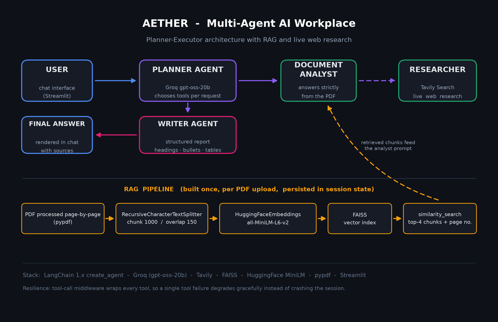

# Aether — Solution Architecture

> A Planner-Executor multi-agent system with retrieval-augmented document
> understanding and live web research, served through a Streamlit chat interface.

## 1. Bird's-eye view



A request flows through **five stages**, then returns as a structured report:

```
User ──▶ Planner Agent ──▶ [ Document Analyst ⇄ RAG pipeline | Researcher ⇄ Tavily ]
                                │
                                ▼
                          Writer Agent ──▶ structured answer in chat
```

## 2. Components

| Component | Responsibility | Key tech |
|---|---|---|
| **Chat UI** | upload PDFs, ask questions, render agent progress | Streamlit (`st.form` chat bar fixed to the bottom, `st.status` progress) |
| **Planner Agent** | understands the request, decides which tools to call, collects their outputs | `langchain.create_agent`, Groq `openai/gpt-oss-20b` |
| **Document Analyst (tool)** | answers strictly from the uploaded PDF, cites page numbers | FAISS retrieval + a strict system prompt |
| **Researcher (tool)** | fetches current web evidence | Tavily Search API, `search_depth="advanced"`, 4 results |
| **Writer Agent** | converts the planner's collected findings into a structured report | `ChatPromptTemplate` → Groq |
| **Tool middleware** | converts any tool exception into a `ToolMessage`, so the session degrades gracefully | `wrap_tool_call` |

## 3. The RAG pipeline (per PDF upload)

```
PDF ──pypdf──▶ page texts (+ page numbers in metadata)
     ──RecursiveCharacterTextSplitter──▶ chunks (size 1000, overlap 150)
     ──HuggingFaceEmbeddings──▶ vectors (all-MiniLM-L6-v2, 384-dim)
     ──FAISS──▶ in-memory index stored in st.session_state
query ──similarity_search(k=4)──▶ top-4 chunks with page numbers
```

Design notes:

- **Page numbers survive chunking** because every chunk inherits its page's
  metadata. This is what allows the Writer to cite sources, and the
  evaluation harness to measure where answers come from.
- **Chunk overlap (150) prevents boundary truncation** — facts that fall at
  the edge of one chunk stay sentence-complete in the next.
- **FAISS over a hosted vector DB** because the workload is *one document per
  session*: in-memory FAISS starts in milliseconds, costs nothing, and dies
  with the session — exactly the promised data lifetime.
- **Session state via `pdf_signature` (`name + size`)** means re-uploading the
  same file does not rebuild the index.

## 4. Why Planner-Executor instead of a single chain?

A fixed chain cannot decide *when a question needs the PDF vs. the web*.
Routing that decision to a planner makes Aether adaptive:

| Request | Planner behaviour |
|---|---|
| "What does section 3 of my PDF say?" | only `document_analyst_tool` |
| "Summarise my PDF and add recent industry context" | both tools, then a fused report |
| "What is the capital of France?" (document mode) | stays inside the strict analyst rules — no outside knowledge |

The planner is deliberately *not* the answerer: it collects findings, and a
separate Writer formats them. This separation keeps strict document rules out
of the tool loop and output format consistent regardless of which tools ran.

## 5. Resilience

Every tool call is wrapped by `wrap_tool_call` middleware. Any exception
becomes a `ToolMessage("Error executing tool: ...")` that the planner can
reason about — so a failing web-search API degrades the session instead of
crashing it. The UI surfaces progress through `st.status`, and PDF parsing
errors appear as inline `st.error` messages rather than exceptions.

## 6. Known limitations (honest, on the roadmap)

- Scanned/image PDFs are rejected (no OCR yet).
- One active PDF per session; multi-doc comparison is future work.
- Responses are not streamed yet.
- Retrieval quality depends on the text-extraction quality of pypdf.
