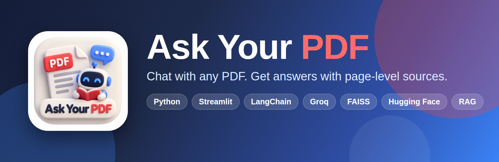
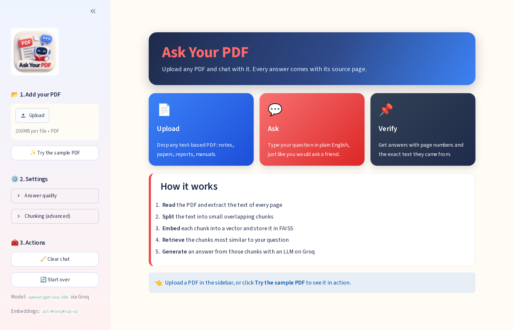
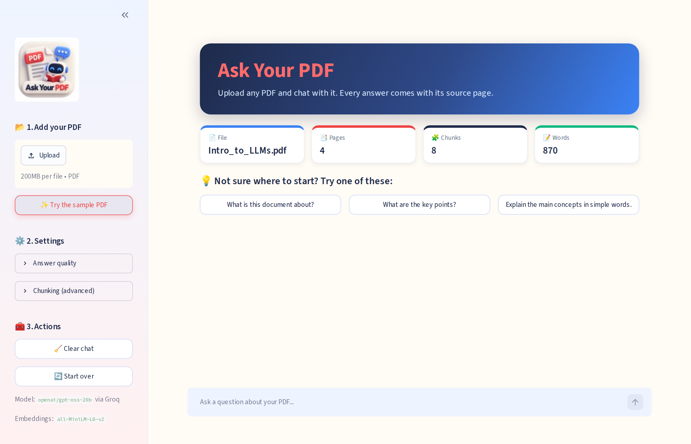
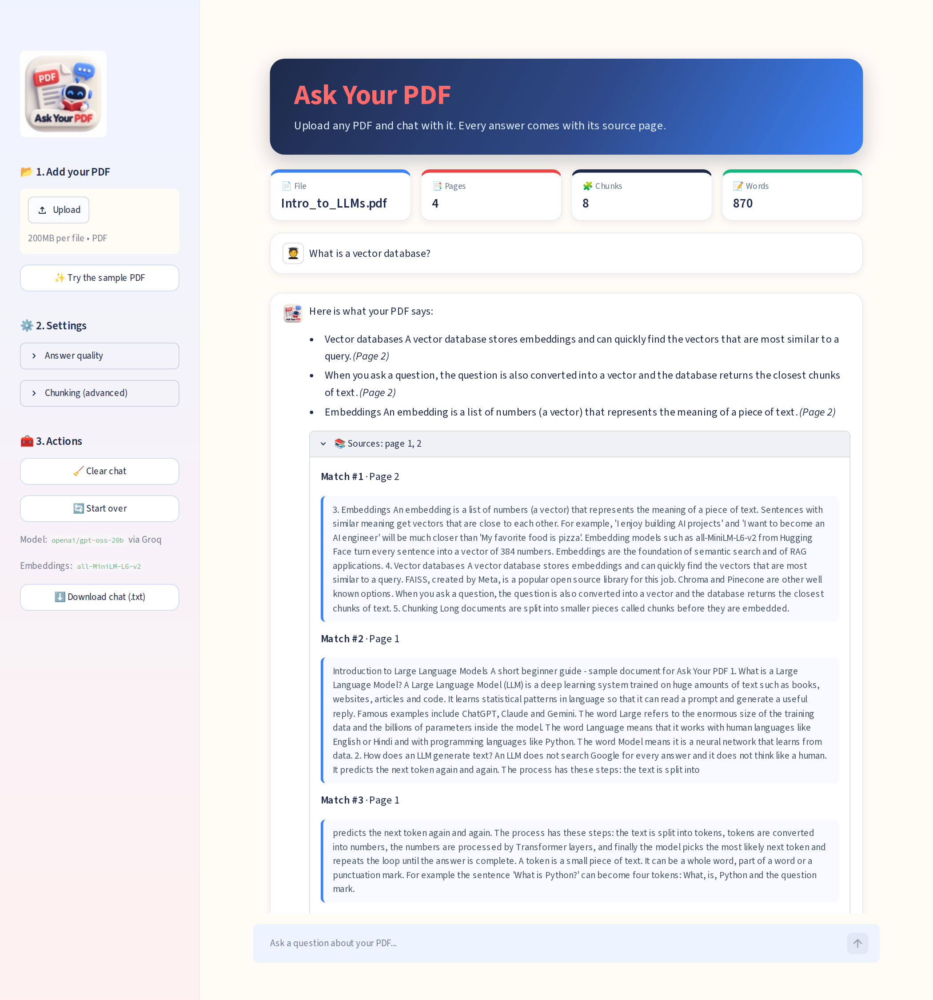
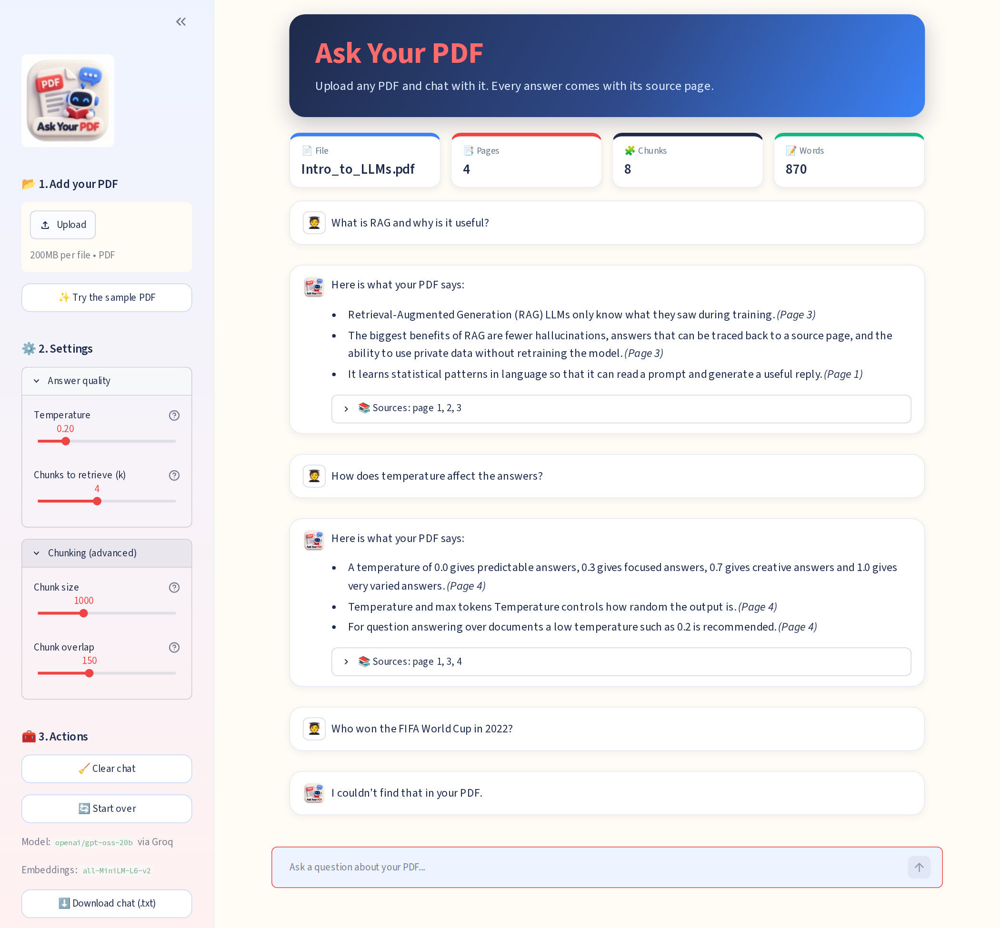
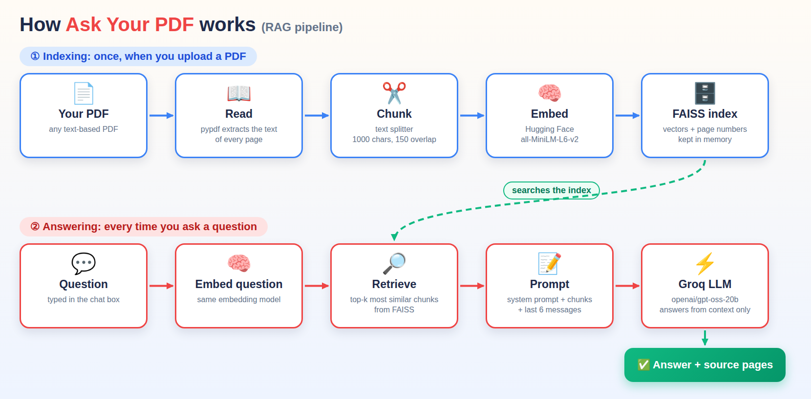

<div align="center">



<br/>

[](https://www.python.org/)
[](https://streamlit.io/)
[](https://www.langchain.com/)
[](https://groq.com/)
[](https://huggingface.co/)
[](https://github.com/facebookresearch/faiss)

[](LICENSE)
[](#)
[](#-contributing)
[](#-author)
[](https://github.com/Rohit-coder-py/Ask-Your-PDF/stargazers)
[](https://github.com/Rohit-coder-py/Ask-Your-PDF/commits/main)

### 📄 Upload a PDF &nbsp;➜&nbsp; 💬 Ask anything &nbsp;➜&nbsp; 📌 Get answers with page numbers

**[🚀 Live Demo](https://ask-your-pdf-genai.streamlit.app/)** &nbsp;•&nbsp; **[✨ Features](#-features)** &nbsp;•&nbsp; **[🧠 How it works](#-how-it-works)** &nbsp;•&nbsp; **[⚙️ Installation](#%EF%B8%8F-getting-started)** &nbsp;•&nbsp; **[📚 Glossary](#-technical-terms-explained)**

</div>

---

## 🚀 Live Demo

<div align="center">

<!-- 👉 Replace the link below with your deployed app URL (for example your Streamlit Community Cloud link) -->

### 🔗 [**Live App**](https://ask-your-pdf-genai.streamlit.app/)


</div>

---

## 📖 Table of Contents

- [🎯 About the Project](#-about-the-project)
- [💡 Why Use It?](#-why-use-it)
- [👥 Who Is It For?](#-who-is-it-for)
- [✨ Features](#-features)
- [📸 Screenshots](#-screenshots)
- [🧠 How It Works](#-how-it-works)
- [📚 Technical Terms Explained](#-technical-terms-explained)
- [🛠️ Tech Stack](#%EF%B8%8F-tech-stack)
- [📂 Project Structure](#-project-structure)
- [⚙️ Getting Started](#%EF%B8%8F-getting-started)
- [🔧 Configuration](#-configuration)
- [💬 Example Questions](#-example-questions)
- [☁️ Deploy to Streamlit Cloud](#%EF%B8%8F-deploy-to-streamlit-community-cloud)
- [⚠️ Limitations](#%EF%B8%8F-limitations)
- [🗺️ Roadmap](#%EF%B8%8F-roadmap)
- [🎓 What I Learned](#-what-i-learned)
- [🤝 Contributing](#-contributing)
- [📄 License](#-license)
- [🙋 Author](#-author)

---

## 🎯 About the Project

Reading a 60-page report just to find one answer is slow. **Ask Your PDF** is a web app that lets you **chat with any PDF document**. You upload a file, type a question in plain English, and the app finds the most relevant parts of the document and writes a clear answer, **always telling you which page it came from.**

It is built with a technique called **RAG (Retrieval-Augmented Generation)**. Instead of sending the whole PDF to the AI, the app first *searches* the document for the passages related to your question, and then asks the language model to answer **using only those passages**. That makes answers faster, cheaper, and far easier to verify.

> 💡 **In one line:** *ChatGPT-style answers, grounded in **your** document, with proof.*

---

## 💡 Why Use It?

| | Benefit | What it means for you |
|---|---|---|
| ⚡ | **Save time** | Get an answer in seconds instead of scrolling through hundreds of pages. |
| 📌 | **Verifiable answers** | Every answer shows its source pages and the exact text it used, so you can double-check. |
| 🎯 | **Stays on topic** | The AI is instructed to answer **only** from your PDF. If the answer is missing, it says so instead of guessing. |
| 💰 | **Free to run** | Embeddings run locally on your computer and Groq offers a free API tier. |
| 🧠 | **Remembers the conversation** | Ask follow-up questions like *"explain that more simply"*. |
| 🔒 | **Nothing is stored** | The PDF is processed in memory and is never saved to a database or to disk by the app. |

---

## 👥 Who Is It For?

| 🎓 Students | 🔬 Researchers | 💼 Professionals | ⚖️ Legal & HR teams | 👨‍💻 Developers |
|---|---|---|---|---|
| Quickly understand lecture notes, textbooks and study material | Skim long papers and pull out methods, results and definitions | Query reports, contracts, manuals and meeting documents | Find clauses and policies inside long agreements | Learn how a real RAG pipeline is built, step by step |

---

## ✨ Features

- 📤 **Upload any text-based PDF** or try the built-in **sample PDF** with one click
- 🔎 **Semantic search**: finds passages by *meaning*, not just matching keywords
- 💬 **Chat interface** with conversation memory for natural follow-up questions
- 📚 **Source citations**: page numbers and the exact chunks behind every answer
- 🚫 **Anti-hallucination prompt**: replies *"I couldn't find that in your PDF"* when the answer isn't there
- 🎛️ **Adjustable settings**: temperature, number of retrieved chunks, chunk size and overlap
- 📊 **Document stats**: pages, chunks and word count at a glance
- 💡 **Starter questions** to get going instantly
- ⬇️ **Download the chat** as a `.txt` file
- 🛡️ **Friendly error handling** for missing API keys, scanned PDFs and network problems
- 🎨 **Colourful, custom-styled UI** built with Streamlit and CSS

---

## 📸 Screenshots

<div align="center">

| 🏠 Home screen | 📑 PDF loaded and ready |
|:---:|:---:|
|  |  |
| **Upload a PDF or try the sample** | **Instant stats and starter questions** |

| 📌 Answers with sources | 💬 Chat, settings & "not found" handling |
|:---:|:---:|
|  |  |
| **Every answer shows the pages and chunks it used** | **Tune the settings, and the app admits when it doesn't know** |

</div>

---

## 🧠 How It Works

<div align="center">

</div>

### ① Indexing: runs once when you upload a PDF

1. 📖 **Read:** `pypdf` extracts the text of every page and remembers each page number.
2. ✂️ **Chunk:** a text splitter cuts the pages into small, overlapping pieces (default: **1000 characters**, **150 overlap**).
3. 🧠 **Embed:** a Hugging Face model (`all-MiniLM-L6-v2`) turns each chunk into a **384-number vector** that represents its meaning.
4. 🗄️ **Store:** all vectors are saved in a **FAISS** index in memory.

### ② Answering: runs for every question

1. 🧠 Your question is converted into a vector with the *same* embedding model.
2. 🔎 FAISS returns the **top-k** chunks whose vectors are closest to the question.
3. 📝 A **prompt template** combines the system rules, those chunks, the **last 6 chat messages** and your question.
4. ⚡ The **Groq** LLM (`openai/gpt-oss-20b`) writes the answer using only the supplied context.
5. ✅ The answer is shown together with its **source pages**.

---

## 📚 Technical Terms Explained

New to Generative AI? Here is every important term used in this project, in plain English.

| Term | Simple explanation |
|---|---|
| **LLM** (Large Language Model) | An AI trained on huge amounts of text that predicts the next token to write answers. Here: `openai/gpt-oss-20b`. |
| **Token** | A small piece of text (a word, part of a word, or punctuation). LLMs read and write in tokens. |
| **RAG** (Retrieval-Augmented Generation) | Find the relevant parts of your own data first, then let the LLM answer using only those parts. |
| **Embedding** | A list of numbers (a *vector*) that captures the meaning of a text. Similar meaning gives similar numbers. |
| **Vector store / FAISS** | A database that stores embeddings and quickly finds the closest ones. FAISS is an open-source library from Meta. |
| **Chunking** | Splitting a long document into smaller pieces so search is accurate and the LLM isn't overloaded. |
| **Chunk overlap** | A few characters shared between neighbouring chunks so no sentence is cut in half. |
| **Similarity search (top-k)** | Returning the *k* chunks whose embeddings are closest to the question's embedding. |
| **Prompt template** | A reusable prompt with variables such as `{context}` that is filled in for every request. |
| **System / Human / AI messages** | The three message roles of a chat model: the rules, the user's input and the model's replies. |
| **Conversation memory** | Sending recent chat messages back to the model so it understands follow-up questions. This app keeps the last 6 to control cost. |
| **Temperature** | Controls randomness. Low (0.2) gives focused, factual answers; high gives more creative ones. |
| **Context window** | The maximum amount of text (in tokens) a model can read at once. RAG helps us stay within it. |
| **Hallucination** | When an LLM states something that sounds right but is false. The system prompt and source citations reduce this. |
| **API key** | A private password that lets your app use a hosted model such as Groq. Never share it. |

---

## 🛠️ Tech Stack

| Layer | Technology | Purpose |
|---|---|---|
| 🖥️ **Frontend** | [Streamlit](https://streamlit.io/) + custom CSS | Web interface, chat UI, file upload |
| 🔗 **Framework** | [LangChain](https://www.langchain.com/) | Prompt templates, messages, text splitter, vector store wrapper |
| ⚡ **LLM** | [Groq](https://groq.com/) · `openai/gpt-oss-20b` | Generates the final answer |
| 🧠 **Embeddings** | [Hugging Face](https://huggingface.co/) · `all-MiniLM-L6-v2` | Converts text into vectors (runs locally) |
| 🗄️ **Vector DB** | [FAISS](https://github.com/facebookresearch/faiss) | Fast similarity search |
| 📖 **PDF parsing** | [pypdf](https://pypdf.readthedocs.io/) | Extracts text page by page |
| 🔐 **Secrets** | python-dotenv | Loads the API key from `.env` |
| 🐍 **Language** | Python 3.10+ | Everything |

---

## 📂 Project Structure

```text
Ask-Your-PDF/
├── 📄 app.py                  # Streamlit user interface
├── 🧠 core.py                 # RAG logic: read, chunk, embed, search, answer
├── 📦 requirements.txt        # Python dependencies
├── 🔐 .env.example            # Template for your API key (copy to .env)
├── 🙈 .gitignore              # Keeps secrets and junk out of Git
├── 📜 LICENSE                 # MIT license
├── 📘 README.md               # You are here
├── 🎨 assets/
│   ├── logo.png               # App logo
│   ├── style.css              # Custom colours and layout
│   ├── banner.png             # README banner
│   └── architecture.png       # Pipeline diagram
├── 📸 preview/                # Screenshots used in this README
├── 📑 sample_data/
│   └── Intro_to_LLMs.pdf      # Sample PDF to try the app instantly
└── ⚙️ .streamlit/
    └── config.toml            # Theme settings
```

---

## ⚙️ Getting Started

### Prerequisites

- **Python 3.10 or newer** ([download](https://www.python.org/downloads/))
- A **free Groq API key** → create one at [console.groq.com](https://console.groq.com/keys)

### Installation

```bash
# 1. Clone the repository
git clone https://github.com/Rohit-coder-py/Ask-Your-PDF.git
cd Ask-Your-PDF

# 2. Create and activate a virtual environment
python -m venv venv
venv\Scripts\activate          # Windows
# source venv/bin/activate     # macOS / Linux

# 3. Install the dependencies
pip install -r requirements.txt

# 4. Add your API key
copy .env.example .env         # Windows
# cp .env.example .env         # macOS / Linux
# then open .env and paste your key:  GROQ_API_KEY=your_real_key

# 5. Run the app
streamlit run app.py
```

The app opens at **http://localhost:8501**. 🎉

> ⏳ **First run:** the embedding model (~90 MB) is downloaded once from Hugging Face. After that it runs offline and starts quickly.

---

## 🔧 Configuration

All settings are available in the sidebar. Defaults are chosen to work well for most documents.

| Setting | Default | What it does |
|---|:---:|---|
| **Temperature** | `0.2` | Lower is more factual, higher is more creative |
| **Chunks to retrieve (k)** | `4` | How many PDF passages are sent to the AI per question |
| **Chunk size** | `1000` | Characters per chunk |
| **Chunk overlap** | `150` | Characters shared between neighbouring chunks |

Model names and the memory limit can be changed at the top of [`core.py`](core.py):

```python
MODEL_NAME = "openai/gpt-oss-20b"
EMBEDDING_MODEL_NAME = "sentence-transformers/all-MiniLM-L6-v2"
MAX_HISTORY_MESSAGES = 6
```

---

## 💬 Example Questions

Click **✨ Try the sample PDF** and ask:

- *What is RAG and why is it useful?*
- *How does temperature affect the answers?*
- *What is the difference between an API model and a local model?*
- *Why do we split documents into chunks?*
- *Who won the FIFA World Cup in 2022?* → the app should reply that it **couldn't find that in your PDF** ✅

---

## ☁️ Deploy to Streamlit Community Cloud

1. Push this project to a **public GitHub repository** (make sure `.env` is **not** uploaded; `.gitignore` already protects it).
2. Go to [share.streamlit.io](https://share.streamlit.io/) and click **New app**.
3. Select your repository, branch `main`, and main file `app.py`.
4. Open **Advanced settings → Secrets** and add:
   ```toml
   GROQ_API_KEY = "your_real_key"
   ```
5. Click **Deploy**, then paste your new URL into the **Live Demo** section at the top of this README.

---

## ⚠️ Limitations

Being honest about what the app can't do yet:

- 🖼️ **Scanned PDFs** (images of text) are not supported because there is no OCR. Use PDFs with selectable text.
- 📊 **Tables, charts and images** inside PDFs are not understood, only plain text.
- 📄 **One PDF at a time.**
- 🔁 **Follow-up retrieval:** the search uses your latest question only, so very short follow-ups like *"why?"* may retrieve weaker chunks.
- 🧪 **LLMs can still make mistakes.** Always check the **Sources** panel for important facts.
- 🌐 **Privacy note:** embeddings are computed locally, but the few chunks relevant to each question are sent to Groq's API to generate the answer. Don't upload highly confidential documents.

---


## 🎓 What I Learned

This project is the practical application of my Generative AI foundations:

| Concept | Where it is used |
|---|---|
| Calling LLMs through an API (**Groq**) | `get_model()` in `core.py` |
| **LangChain** chat models and messages | `SystemMessage`, `HumanMessage`, `AIMessage` |
| **Prompt templates** and system prompts | `ChatPromptTemplate` with a `{context}` variable |
| **Embeddings** with Hugging Face models | `HuggingFaceEmbeddings` |
| **Chunking** and **indexes** (retrieval) | Text splitter + FAISS vector store |
| **RAG** pipeline end to end | `read_pdf` → `split_into_chunks` → `build_vector_store` → `ask_pdf` |
| **Short-term memory** and its limits | Chat history trimmed to the last 6 messages |
| Temperature control | Sidebar slider |
| Streamlit **session state** and caching | `st.session_state`, `@st.cache_resource` |
| Project structure and secrets handling | Separate `core.py` / `app.py`, `.env`, `.gitignore` |

---

## 🤝 Contributing

Contributions, issues and feature ideas are welcome!

1. 🍴 Fork the project
2. 🌿 Create a branch: `git checkout -b feature/amazing-idea`
3. 💾 Commit your changes: `git commit -m "Add amazing idea"`
4. 📤 Push the branch: `git push origin feature/amazing-idea`
5. 🔃 Open a Pull Request

---

## 📄 License

Distributed under the **MIT License**. See [`LICENSE`](LICENSE) for details.

---

## 🙋 Author

<div align="center">

### **Rohit Jha**
*Aspiring AI / ML Engineer*

[](https://github.com/Rohit-coder-py)
[](https://linkedin.com/in/rohit-jha-ai)

<br/>

### ⭐ If you found this project useful, please give it a star! ⭐

*Built with ❤️ using Python, LangChain and Streamlit.*

</div>
