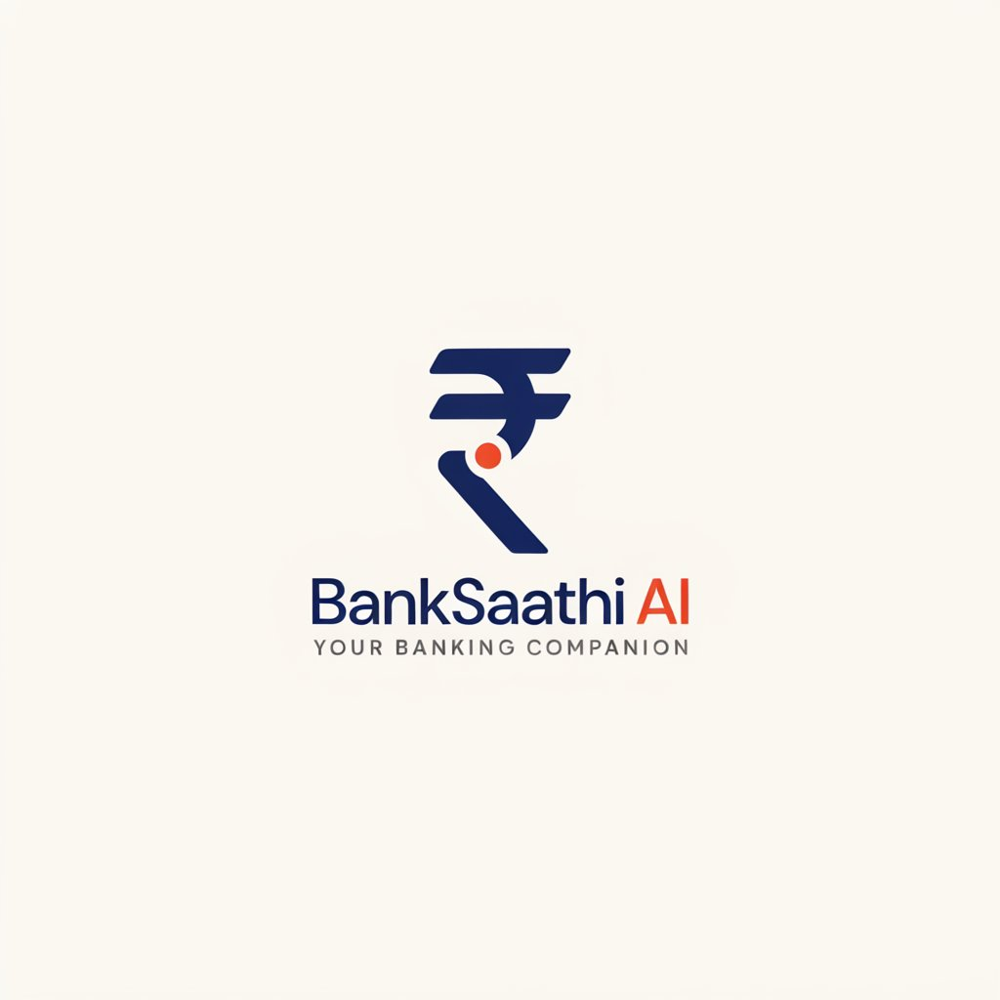
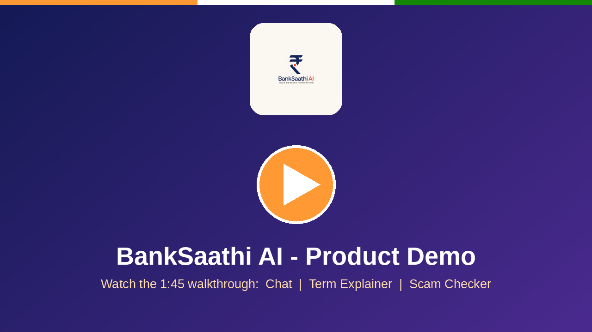
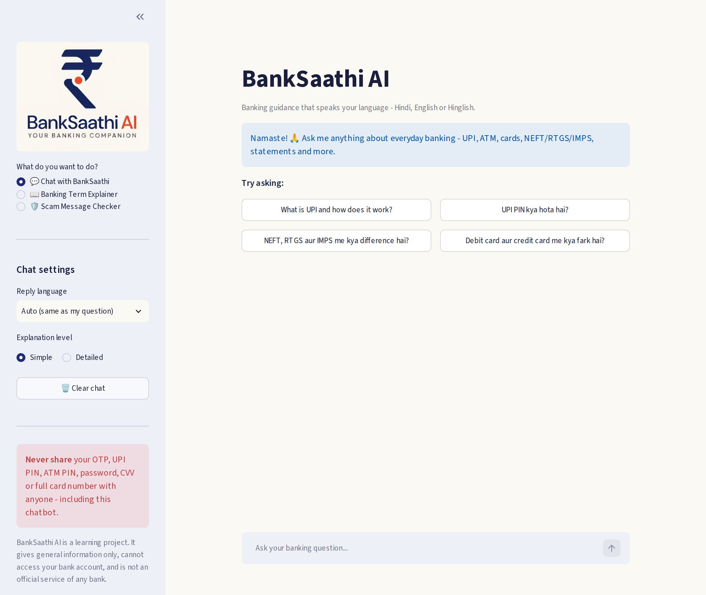
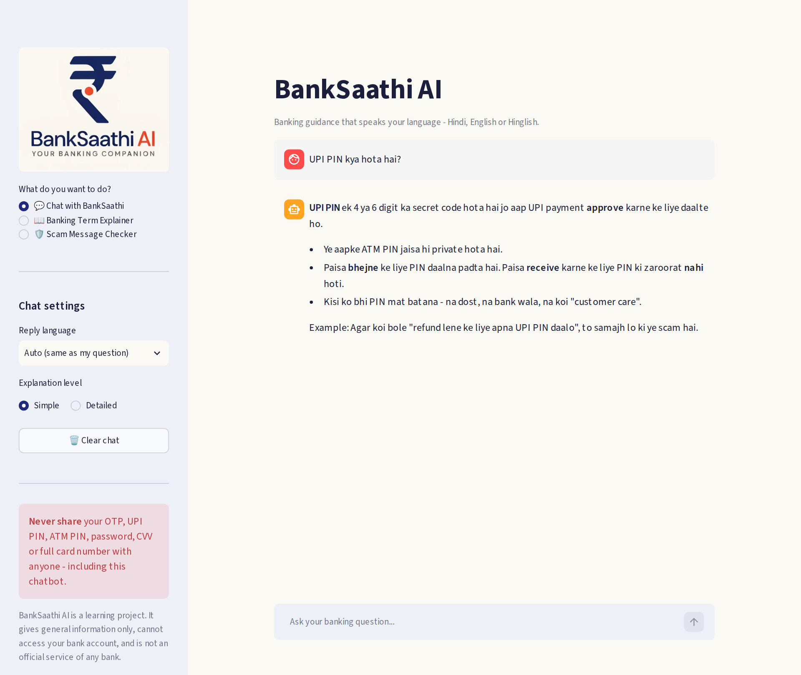
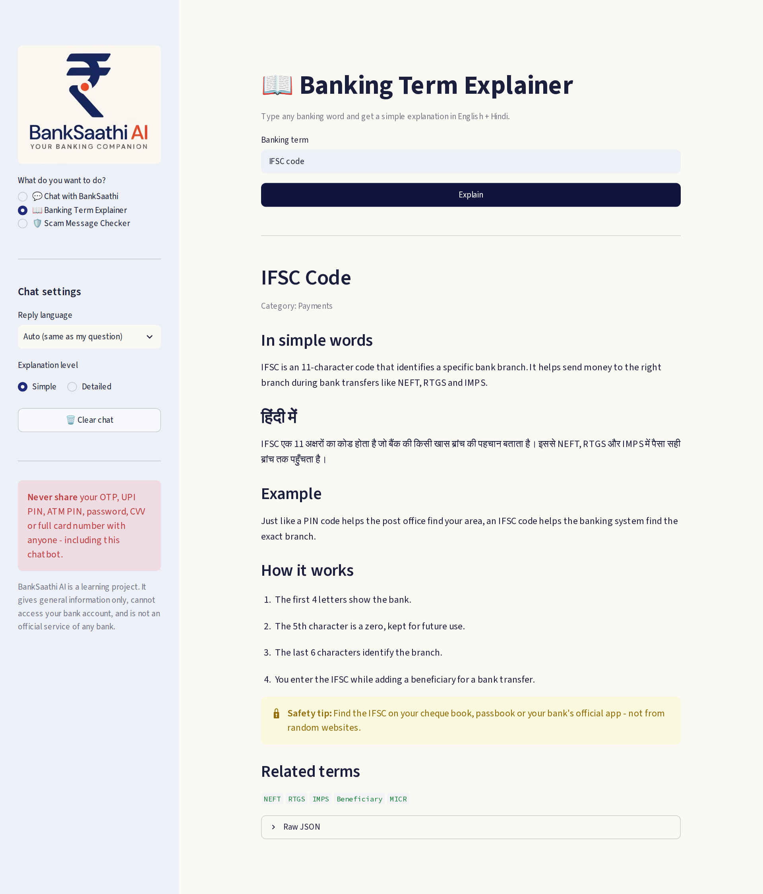
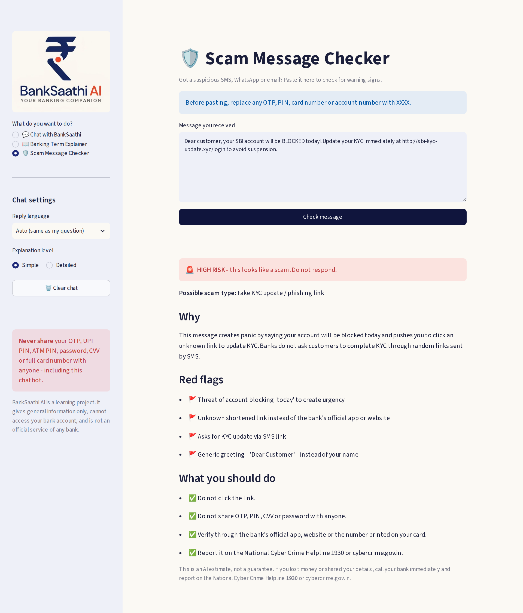
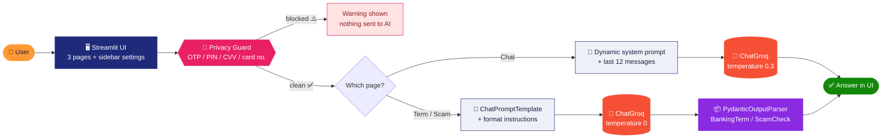

<!--
  ✏️ TO DO AFTER DEPLOYING: replace every  https://your-app-name.streamlit.app  in this file with your real app URL.
  (Search for "your-app-name" - it appears in the badges row, the nav bar and the Live Demo section.)
-->

<div align="center">




### 🇮🇳 &nbsp;हिन्दी &nbsp;•&nbsp; English &nbsp;•&nbsp; Hinglish &nbsp;🇮🇳

**An AI banking companion that explains UPI, NEFT, EMI, KYC & more in simple words, and helps you spot scam messages before you click.**

<br/>

[](https://your-app-name.streamlit.app)
[](preview/banksaathi-demo.mp4)
[](#-about-the-author)


<br/>

[**🎬 Demo**](#-product-demo) &nbsp;•&nbsp;
[**✨ Features**](#-features) &nbsp;•&nbsp;
[**👥 Who It's For**](#-who-is-it-for) &nbsp;•&nbsp;
[**🧠 Tech**](#-how-it-works-technical-overview) &nbsp;•&nbsp;
[**⚡ Quick Start**](#-quick-start) &nbsp;•&nbsp;
[**🔒 Safety**](#-safety--privacy)

</div>

---

## 🌐 Live Demo

> 🚧 **Deployment coming soon.** The link below is a placeholder and will be updated when the app goes live.

### 👉 [**https://your-app-name.streamlit.app**](https://your-app-name.streamlit.app)

---

## 🎬 Product Demo

A ~1 minute 45 second walkthrough covering **the problem, who the app is for, a live tour of all three tools, how it works under the hood, and why you would use it.**

<div align="center">

[](preview/banksaathi-demo.mp4)

*Click the image to play the video.*

</div>

### 📸 Screenshots

<table>
  <tr>
    <td align="center" width="50%">
      <br/>
      <b>💬 Chat home</b><br/><sub>Welcome message, one-tap example questions, language &amp; detail settings</sub>
    </td>
    <td align="center" width="50%">
      <br/>
      <b>🗣️ Hinglish answers</b><br/><sub>Ask in Hinglish, get a reply in Hinglish with a real-life example</sub>
    </td>
  </tr>
  <tr>
    <td align="center" width="50%">
      <br/>
      <b>📖 Banking Term Explainer</b><br/><sub>Meaning, Hindi translation, example, steps, safety tip &amp; related terms</sub>
    </td>
    <td align="center" width="50%">
      <br/>
      <b>🛡️ Scam Message Checker</b><br/><sub>Risk level, red flags and exactly what to do next</sub>
    </td>
  </tr>
</table>

---

## 💡 What is BankSaathi AI?

**BankSaathi AI** is a multilingual, AI-powered banking **information** assistant. *"Saathi"* (साथी) means *companion*, and that is the idea: a friendly guide that explains everyday banking in the language you are most comfortable with.

Banking is full of jargon (NEFT, RTGS, IMPS, IFSC, KYC, EMI…), most explanations are written in formal English, and fake "KYC update" or "account blocked" messages are a constant threat. BankSaathi AI tackles all three problems in one simple app.

> ⚠️ **BankSaathi AI never touches your bank account.** It gives general information only, so it cannot check balances, move money or block cards.

---

## 👥 Who Is It For?

| | Who | What they struggle with | How BankSaathi AI helps |
|---|---|---|---|
| 🎓 | **Students & first-time account holders** | New to UPI, debit cards, statements, IFSC | Plain-language explanations with real-life examples |
| 👨‍👩‍👧 | **Families & senior citizens** | Fear of making a mistake or being tricked | Patient follow-up questions + a scam checker for suspicious messages |
| 🗣️ | **Hindi & Hinglish speakers** | Most banking content is formal English | Ask and receive answers in हिन्दी, English or Hinglish |
| 🛒 | **Small shop owners using UPI** | Understanding payment flows and PIN safety | Clear explanations of UPI, NEFT/RTGS/IMPS and safe practices |
| 📱 | **Anyone who just got a "suspicious" SMS** | "Is this real or a scam?" | Paste it in, get a risk level, red flags and next steps |

---

## 🤔 Why Use BankSaathi AI?

- 🗣️ **Speak naturally:** ask in Hindi, English or Hinglish and get a reply in the same language.
- 🧒 **Simple or detailed:** switch between a short, beginner-friendly answer and a step-by-step one.
- 🛡️ **Spot scams early:** a dedicated checker explains *why* a message looks risky.
- 🔐 **Private by design:** OTPs, PINs, CVVs and long card numbers are blocked **before** they reach the AI.
- 🎯 **Honest about limits:** the AI is instructed not to invent fees, limits or interest rates, and to point you to your bank, RBI or NPCI instead.
- 🚪 **Zero friction:** no sign-up, no bank login. Just ask.

---

## ✨ Features

| Page | What it does | Highlights |
|---|---|---|
| 💬 **Chat with BankSaathi** | Multilingual banking chatbot with conversation memory | Reply-language selector (Auto / Hindi / Hinglish / English) • Simple vs Detailed mode • One-tap example questions • Clear-chat button |
| 📖 **Banking Term Explainer** | Type a term (EMI, KYC, IFSC…) and get a structured explanation | English + Hindi meaning • Real-life example • How it works (steps) • Safety tip • Related terms • Raw JSON view |
| 🛡️ **Scam Message Checker** | Paste a suspicious SMS / WhatsApp / email | **Low / Medium / High** risk badge • Scam type • Red flags • "What you should do" checklist • Cyber-crime helpline reminder (1930) |

---

## 🧠 How It Works (Technical Overview)

### Architecture



### 🧰 Tech Stack

| Layer | Technology | Used for |
|---|---|---|
| 🐍 Language | **Python 3.10+** | Application logic |
| 🖥️ UI | **Streamlit** | Chat UI, multi-page sidebar navigation, session state, themed via `.streamlit/config.toml` |
| 🔗 Orchestration | **LangChain** (`langchain-core`, `langchain-groq`) | Prompt templates, message roles, model wrapper, output parsing |
| ⚡ LLM inference | **Groq** · model `openai/gpt-oss-20b` | Fast hosted inference |
| 📦 Validation | **Pydantic** | Typed schemas for structured AI output |
| 🔑 Config | **python-dotenv** | Loading `GROQ_API_KEY` from `.env` |

### 🔬 Key Concepts Implemented

| Concept | Where / how it is used |
|---|---|
| **Chat models & sampling control** | `ChatGroq` is created twice: **temperature 0.3** for natural but focused chat, **temperature 0** for predictable structured extraction. Both are cached with `@st.cache_resource`. |
| **Dynamic system prompts** | `build_system_prompt()` rebuilds the `SystemMessage` on every call from the sidebar choices (language + detail level), so setting changes apply instantly. |
| **Message roles & short-term memory** | Conversation is stored as `HumanMessage` / `AIMessage` objects in `st.session_state`; the system message is added fresh each turn. |
| **Sliding-window memory** | Only the last `MAX_HISTORY_MESSAGES = 12` messages are sent to the model, which keeps context (and cost/latency) bounded. |
| **Prompt templates** | `ChatPromptTemplate` with `{term}`, `{message}` and `{format_instructions}` placeholders for the two structured tools. |
| **Structured output** | `PydanticOutputParser` converts the LLM reply into validated `BankingTerm` and `ScamCheck` objects, which drive the UI (badges, lists, JSON view). |
| **Guard-rail prompting** | Prompts forbid inventing fees/limits/rates, require "unsure" over guessing, restrict the bot to banking topics and always route fraud to 1930 / cybercrime.gov.in. |
| **Privacy guard (pre-LLM filter)** | `contains_sensitive_info()` blocks a message *before* any API call when it has a secret word (OTP, PIN, CVV, password, passcode) **plus** 4+ digits, or any run of 12+ digits (card / Aadhaar-length numbers). It is a simple heuristic, so treat it as a safety net, not a guarantee. |
| **Graceful error handling** | Failed calls remove the unanswered question from history and show a friendly error instead of crashing. |

### 🗂️ Project Structure

```text
BankSaathi AI/
├── 📁 app/
│   └── app.py                 # Entire Streamlit app (UI + LLM logic)
├── 📁 assests/
│   ├── logo.jpg               # Full logo (README)
│   └── logo_small.jpg         # Sidebar / page icon
├── 📁 preview/
│   ├── 01-chat-home.png       # Screenshots
│   ├── 02-chat-hinglish.png
│   ├── 03-term-explainer.png
│   ├── 04-scam-checker.png
│   ├── banksaathi-demo.mp4    # Product demo video
│   └── video-thumbnail.png    # Poster image used in this README
├── 📁 .streamlit/
│   └── config.toml            # Theme (indigo + cream)
├── .env.example               # Copy to .env and add your key
├── .gitignore
├── requirements.txt
├── What is BankSaathi AI.md   # Plain-language project description
└── README.md
```

---

## ⚡ Quick Start

**Prerequisites:** Python 3.10+ and a free [Groq API key](https://console.groq.com/keys).

```bash
# 1. Clone the repository
git clone https://github.com/Rohit-coder-py/BankSaathi-AI.git
cd BankSaathi-AI

# 2. (Recommended) create a virtual environment
python -m venv .venv
source .venv/bin/activate        # Windows: .venv\Scripts\activate

# 3. Install dependencies
pip install -r requirements.txt

# 4. Add your API key
cp .env.example .env             # Windows: copy .env.example .env
#    then open .env and set GROQ_API_KEY="your_real_key"

# 5. Run the app (from the project folder)
streamlit run app/app.py
```

The app opens at **http://localhost:8501** 🎉

### ☁️ Deploying on Streamlit Community Cloud

1. Push this repo to GitHub (**never** commit `.env`; it is already in `.gitignore`).
2. On [share.streamlit.io](https://share.streamlit.io), create a new app and set the main file path to `app/app.py`.
3. In **Advanced settings → Secrets**, add `GROQ_API_KEY = "your_real_key"`.
4. Deploy, then paste the live URL into the `your-app-name` placeholders at the top of this README.

---

## 🔒 Safety & Privacy

> [!WARNING]
> **Never share your OTP, UPI PIN, ATM PIN, password, CVV or full card number in any chat**, including this one.

- 🚫 The app **does not** access bank accounts, check balances, verify transactions, move money or block cards.
- 🔐 Messages that look like they contain secrets are stopped **before** they are sent to the AI.
- 📉 Fees, limits, timings and interest rates differ between banks, so the assistant tells you to confirm with your bank's official app/website, **RBI** or **NPCI**.
- 🧠 AI can make mistakes. Always verify important information through official channels.
- 🚨 **Lost money or shared your details?** Call your bank immediately and report on the **National Cyber Crime Helpline 1930** or at **cybercrime.gov.in**.

---

## 🗺️ Roadmap Ideas

- [ ] 🌐 More Indian languages (Marathi, Tamil, Bengali…)
- [ ] 🎙️ Voice input for hands-free questions
- [ ] 📚 Retrieval-augmented answers from official RBI / NPCI documents
- [ ] 🧪 Automated tests for the privacy guard and parsers
- [ ] 📱 Mobile-friendly layout polish

---

## 👨‍💻 About the Author

<div align="center">

**Rohit Jha**: building AI/ML and GenAI projects.

[](https://github.com/Rohit-coder-py)
[](https://linkedin.com/in/rohit-jha-ai)

⭐ **If this project helped you, please consider giving it a star!** ⭐

</div>

---

## 📄 Disclaimer

BankSaathi AI is an educational / portfolio project that provides **general banking information only**. It is **not** an official service of any bank, is not affiliated with RBI or NPCI, and does not offer financial, legal or investment advice.

<div align="center">


**BankSaathi AI: Your banking companion, in your language.**

</div>
