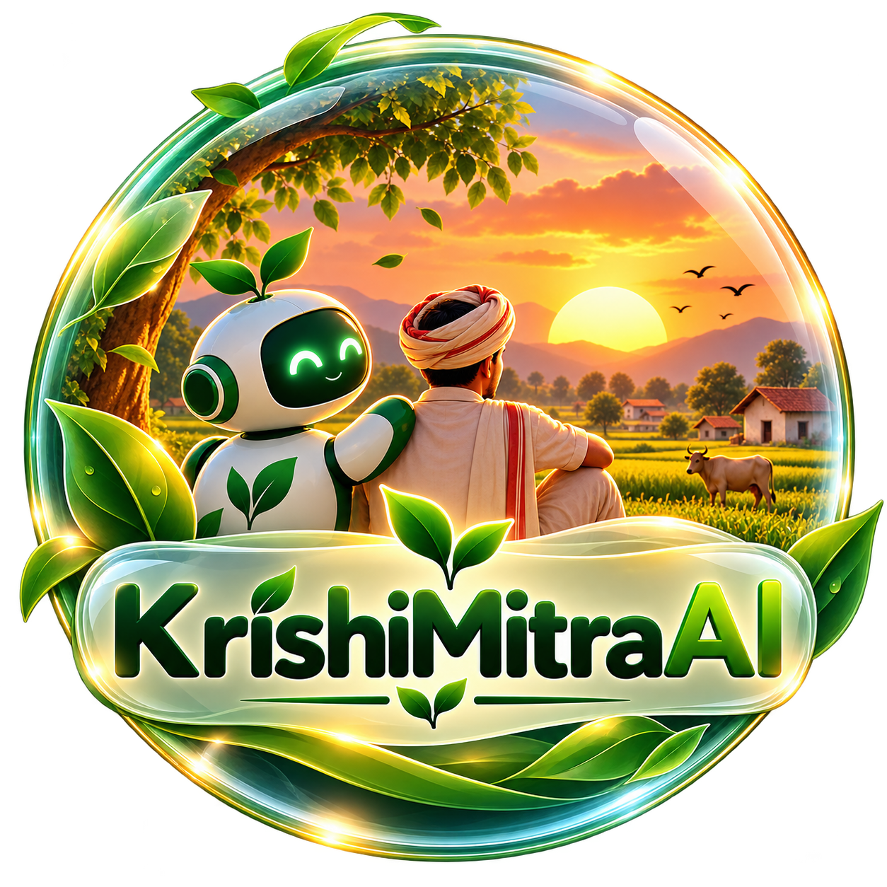

<mark> **This is a learning Project i tried to implement Gen AI and RAG Pipeline and also learning them** 
 
<div align="center">



# 🌾 KrishiMitra AI

**A RAG-powered farming assistant — ask questions in plain language, get answers grounded in real documents.**

[](YOUR_LIVE_LINK_HERE)


</div>

---

## This project is not deployed so unfortunately you cant use this project directly 
---

## ✨ Features

- 💬 **Conversational Q&A** about farming — irrigation, soil fertility, pest control and more
- 📄 **Bring your own PDF** — upload one or more documents and chat with them instantly
- 🌱 **Built-in farming guide** — works out of the box with a pre-indexed knowledge base
- 🔎 **Source transparency** — every answer can show the exact chunks (file + page) it was based on
- 🧠 **Follow-up questions** — keeps the last few turns of the conversation as context
- 🎛️ **Tunable retrieval** — choose how many chunks to retrieve and the model temperature
- ⚡ **Streaming responses** powered by Groq
- 🛡️ **Honest by design** — warns when the document isn't about farming and says so when the context doesn't contain the answer

## 🧠 How it works

```
 PDF ─► text extraction ─► chunks (1000 chars, 200 overlap) ─► embeddings ─► Chroma
                                                                               │
 Question ─► embed ─► top-k similar chunks ─────────────────────────────────────┘
                              │
                              ▼
              prompt = system rules + retrieved context + chat history + question
                              │
                              ▼
                     Groq LLM (gpt-oss-20b) ─► streamed answer + sources
```

| Layer | Choice |
|---|---|
| UI | Streamlit |
| Orchestration | LangChain |
| Embeddings | `Qwen/Qwen3-Embedding-0.6B` (Hugging Face, runs on CPU) |
| Vector store | ChromaDB (persisted in `vectorstore/`) |
| LLM | `openai/gpt-oss-20b` via Groq |

## 📁 Project structure

```
Krishi_Mitra_AI/
├── app.py                  # Streamlit app (entry point)
├── requirements.txt
├── Dockerfile              # for Hugging Face Spaces / Render / Railway
├── .env.example            # copy to .env and add your key
├── .streamlit/
│   ├── config.toml         # theme + server settings
│   └── secrets.toml.example
├── vectorstore/            # pre-built Chroma DB of the default farming guide
├── data/
│   └── farming_guide.pdf   # source PDF of the default knowledge base
├── assets/logo.png
├── scripts/
│   ├── create_vectordb.py  # (re)build the vector store from any PDF
│   ├── cli_chat.py         # terminal version of the RAG chat
│   └── txt_qa.py           # minimal "stuff the whole file in the prompt" demo
├── notes/                  # study notes + extra sample knowledge files
└── docs/                   # project write-up and presentation
```

All paths are resolved relative to the project folder, so the app runs the same from any working directory.

## 🚀 Run locally

**Prerequisites:** Python 3.11+ and a free [Groq API key](https://console.groq.com/keys).

```bash
# 1. Clone
git clone https://github.com/<your-username>/<your-repo>.git
cd <your-repo>

# 2. Create a virtual environment
python -m venv .venv
source .venv/bin/activate          # Windows: .venv\Scripts\activate

# 3. Install dependencies
pip install -r requirements.txt

# 4. Add your API key
cp .env.example .env               # Windows: copy .env.example .env
#    then open .env and set GROQ_API_KEY=...

# 5. Launch
streamlit run app.py
```

The first launch downloads the embedding model (~1.2 GB) and caches it; later starts are fast.

## ⚙️ Configuration

| Variable | Required | Default | Description |
|---|---|---|---|
| `GROQ_API_KEY` | ✅ | — | Groq API key |
| `LLM_MODEL` | ❌ | `openai/gpt-oss-20b` | Any chat model available on Groq |
| `EMBED_MODEL` | ❌ | `Qwen/Qwen3-Embedding-0.6B` | Must match the model the vector store was built with |

Set them in `.env` locally, or as **Secrets / Environment variables** on your host.

## ☁️ Deploy

> ⚠️ The embedding model needs roughly **2–3 GB of RAM**. Hugging Face Spaces (16 GB free) is the safest free host. Streamlit Community Cloud's free tier has less memory and may restart the app under load.

### Option A — Hugging Face Spaces (recommended)

1. Create a new Space → SDK: **Docker** → blank template.
2. Push this repo to the Space, and add this block at the very top of the Space's `README.md`:
   ```yaml
   ---
   title: KrishiMitra AI
   emoji: 🌾
   colorFrom: green
   colorTo: green
   sdk: docker
   app_port: 7860
   ---
   ```
3. In **Settings → Variables and secrets**, add the secret `GROQ_API_KEY`.
4. The Space builds from the included `Dockerfile` and goes live.

### Option B — Streamlit Community Cloud

1. Push this repo to GitHub (make sure `.env` is **not** committed — it's in `.gitignore`).
2. Go to [share.streamlit.io](https://share.streamlit.io) → **New app** → pick the repo, branch `main`, main file `app.py`.
3. Under **Advanced settings → Secrets**, paste:
   ```toml
   GROQ_API_KEY = "your_groq_api_key_here"
   ```
4. Deploy.

### Option C — Render / Railway / Fly.io

Deploy from the `Dockerfile`, set `GROQ_API_KEY` as an environment variable, and use the `PORT` the platform provides (the container already honours `$PORT`).

## 🔄 Using your own knowledge base

Upload PDFs from the sidebar at runtime, **or** replace the default knowledge base permanently:

```bash
python scripts/create_vectordb.py --pdf path/to/your_document.pdf
```

This rebuilds `vectorstore/`. Commit the new folder to deploy it.

## ⚠️ Limitations

- Answers are only as good as the documents provided; scanned (image-only) PDFs need OCR first.
- Not a substitute for a qualified agronomist — verify pesticide, treatment or financial decisions with local experts and official sources.
- Does not fetch live weather, market prices or current scheme details.

## 🗺️ Roadmap

- [ ] Hindi and regional-language support
- [ ] Image-based crop disease detection
- [ ] Live weather and mandi price integrations
- [ ] OCR for scanned PDFs

## 📜 License

Released under the [MIT License](LICENSE).

## 👤 Author

**Harsh** — BCA student & aspiring data scientist
🔗 GitHub: [@your-username](https://github.com/your-username) · 💼 LinkedIn: [your-profile](https://linkedin.com/in/your-profile)

---

<div align="center">

If you found this useful, consider giving the repo a ⭐

</div>
