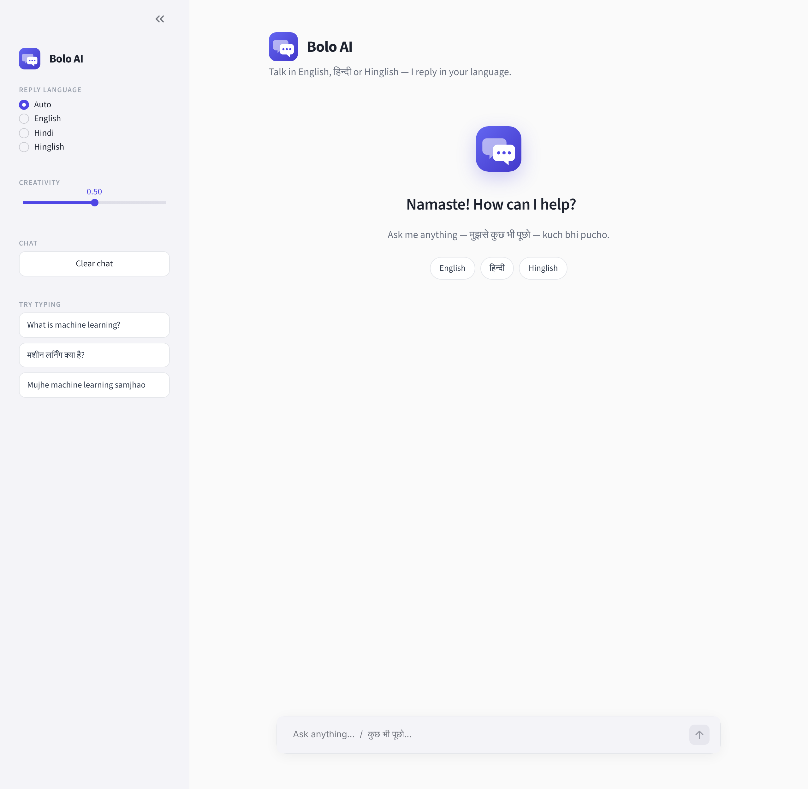
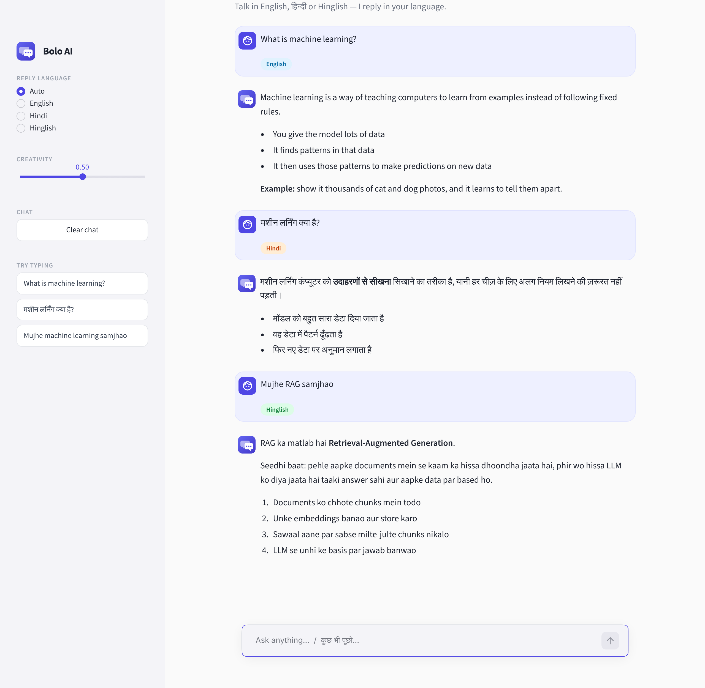
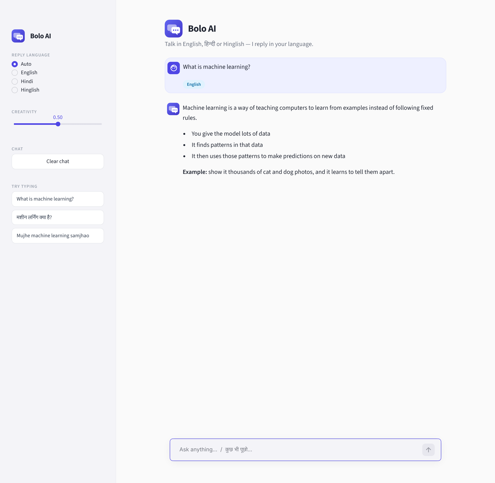
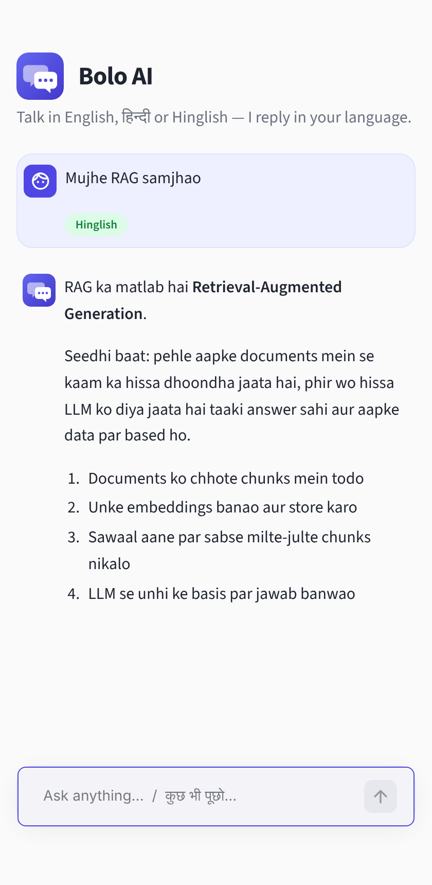

<div align="center">


# Bolo AI — Multilingual Chatbot

**Talk in English, हिन्दी or Hinglish — the bot replies in your language.**


### 🔗 [Live App](#) &nbsp;·&nbsp; *add your deployed link here*

</div>

---

## Preview

<p align="center">
  
</p>

<p align="center">
  
</p>

<table>
  <tr>
    <td width="62%"></td>
    <td width="38%"></td>
  </tr>
  <tr>
    <td align="center"><sub>Desktop</sub></td>
    <td align="center"><sub>Mobile</sub></td>
  </tr>
</table>

## Features

- **Auto language reply** — write in English, Hindi (देवनागरी) or Hinglish and get a reply in the same language
- **Language override** — force English / Hindi / Hinglish from the sidebar
- **Language badge** — every message shows what language was detected
- **Chat memory** — the bot remembers the whole conversation
- **Creativity slider** — control the model's temperature
- **Clear chat** button, clean minimal UI, works on mobile

## Tech stack

| Part | Tool |
|---|---|
| UI | Streamlit |
| LLM | Groq — `openai/gpt-oss-20b` via `langchain-groq` |
| Prompting | LangChain `ChatPromptTemplate` |
| Memory | `HumanMessage` / `AIMessage` list in `st.session_state` |
| Config | `python-dotenv` |

## How it works

```
User message
   │
   ▼
detect_language()  ── Devanagari? → Hindi │ Roman-Hindi words? → Hinglish │ else English
   │
   ▼
ChatPromptTemplate  ── fills {language_rule} (Auto, or the language picked in the sidebar)
   │
   ▼
System prompt + full chat history  ──►  ChatGroq  ──►  Reply in the same language
```

## Run locally

```bash
# 1. install
pip install -r requirements.txt

# 2. add your key (copy .env.example to .env)
GROQ_API_KEY=your_groq_api_key_here

# 3. run
streamlit run app.py
```

Get a free Groq key at [console.groq.com](https://console.groq.com).

## Project structure

```
├── app.py               # the whole app (UI + logic)
├── assets/              # logo (svg + png)
├── preview/             # screenshots used in this README
├── .streamlit/config.toml   # light theme
├── requirements.txt
├── .env.example         # copy to .env
└── .gitignore           # keeps .env out of GitHub
```

> ⚠️ Never upload your real `.env` to GitHub. It is already listed in `.gitignore`.

## Ideas to extend

- Add more languages (Marathi, Bengali, ...) in `language_rules`
- Stream the reply token by token
- Save and load past chats
