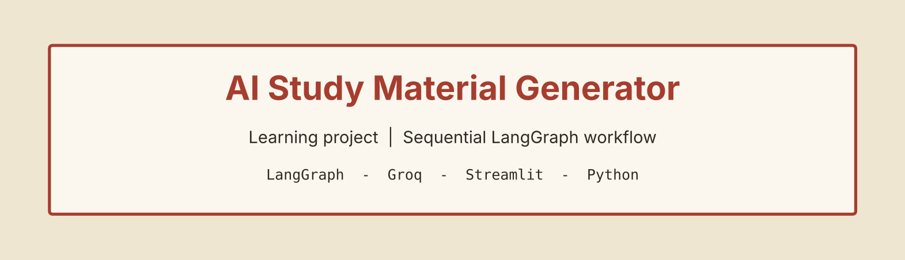
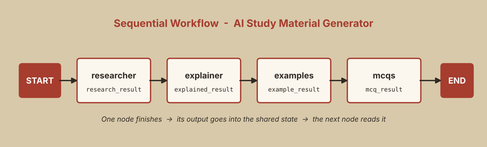

<p align="center">
  
</p>

<p align="center">
  
  
  
  
  
</p>

# 📘 AI Study Material Generator

An agentic AI app that turns **any topic** into a complete study pack: a research report, a beginner-friendly explanation, practical examples and 5 MCQs, all generated by four LangGraph nodes running one after another.

> 📚 **Learning project**
> This project was built **to learn how sequential workflows work in LangGraph**: shared state, nodes, edges and prompt chaining. It is a hands-on learning exercise, not a production system.

---

## 📑 Table of Contents

- [Features](#-features)
- [Workflow](#-workflow)
- [How it works](#-how-it-works)
- [Concepts practiced](#-concepts-practiced)
- [UI design](#-ui-design)
- [Tech stack](#-tech-stack)
- [Project structure](#-project-structure)
- [Setup & run](#-setup--run)
- [What I learned](#-what-i-learned)
- [Future improvements](#-future-improvements)
- [Author](#-author)

---

## ✨ Features

- Enter any topic and get **four outputs in one click**
- 🔍 **Research**: a comprehensive research report on the topic
- 🧠 **Explanation**: the research rewritten in a beginner-friendly way
- 💻 **Examples**: practical examples based on the explained concepts
- ✅ **MCQs**: exactly 5 questions with options A to D, one correct answer and a short explanation
- Simple **Streamlit UI** with an Origami Folded Corner paper design
- Also works as a plain terminal script (asks for a topic with `input()`)

---

## 🔄 Workflow

<p align="center">
  
</p>

The graph is **sequential**: each node waits for the previous one, because it needs that node's output.

```text
START → researcher → explainer → examples → mcqs → END
```

---

## ⚙️ How it works

All nodes share one **state** object:

```python
class StudyState(TypedDict):
    study_topic: str
    research_result: str
    explained_result: str
    example_result: str
    mcq_result: str
```

| Step | Node | Role | Reads | Writes |
|------|------|------|-------|--------|
| 1 | `researcher` | Acts as an expert researcher and writes a comprehensive report | `study_topic` | `research_result` |
| 2 | `explainer` | Acts as an expert teacher and explains the research for beginners | `research_result` | `explained_result` |
| 3 | `examples` | Acts as a practical instructor and generates examples | `study_topic`, `explained_result` | `example_result` |
| 4 | `mcqs` | Acts as an exam paper setter and writes 5 MCQs | `study_topic`, `explained_result`, `example_result` | `mcq_result` |

**A small design choice:** the MCQ prompt only receives the first 4000 characters of the explanation and the first 1500 characters of the examples. This keeps the final prompt short while still covering the key concepts.

The MCQ prompt also has clear requirements: four options per question, one correct answer, a 1 to 2 line explanation, different concepts covered and no repetitive questions.

---

## 🧠 Concepts practiced

- Defining shared **state** with `TypedDict`
- Writing **nodes** as plain Python functions that return partial state updates
- Connecting nodes using **sequential edges** with `StateGraph`
- **Prompt chaining**: output of one prompt becomes input of the next
- **Role-based prompting** (researcher, teacher, instructor, paper setter)
- Keeping prompt size under control by slicing earlier outputs
- Adding a **Streamlit UI** on top of an existing graph without changing its logic
- Using `st.session_state` so results stay on screen after the page reruns

---

## 🎨 UI design

The UI uses the **Origami Folded Corner** style, built with custom CSS inside Streamlit:

- Every card looks like a paper sheet with its **top-right corner cut** using `clip-path`
- A small **shaded triangle** on that corner acts as the folded flap
- Warm cream background (`#efe6d2`) with terracotta headings
- The button also has a small folded corner

The page has a header card, an input card and one card per output (Research, Explanation, Examples, MCQs).

---

## 🛠️ Tech stack

| Area | Tools |
|------|-------|
| Language | Python |
| Workflow engine | LangGraph (`StateGraph`) |
| LLM | Groq via `langchain-groq` (`openai/gpt-oss-20b`, temperature 0.7) |
| UI | Streamlit + custom CSS |
| Config | `python-dotenv` |

---

## 📂 Project structure

```text
01_sequential_workflows/
├── AI_Study_Material_Generator.py
├── README.md
├── requirements.txt
├── .env.example
├── .gitignore
└── assets/
    ├── banner.png
    └── workflow.png
```

---

## 🚀 Setup & run

**1. Create a virtual environment (recommended)**

```bash
python -m venv .venv
# Windows
.venv\Scripts\activate
# macOS / Linux
source .venv/bin/activate
```

**2. Install dependencies**

```bash
pip install -r requirements.txt
```

**3. Add your Groq API key**

Get a free key from the [Groq Console](https://console.groq.com/) and create a `.env` file in this folder (see `.env.example`):

```env
GROQ_API_KEY=your_groq_api_key_here
```

> 🔐 Never commit your `.env` file. It is already listed in `.gitignore`.

**4. Run the app**

With the Streamlit UI:

```bash
streamlit run AI_Study_Material_Generator.py
```

Or as a terminal script (it will ask for a topic):

```bash
python AI_Study_Material_Generator.py
```

---

## 🎓 What I learned

- How LangGraph represents an AI app as **state + nodes + edges**
- How to **chain prompts** so each step builds on the previous one
- Why prompt size matters and how slicing earlier outputs helps
- How to give an existing script a clean **UI without touching its core code**
- How custom CSS can make a Streamlit app feel designed instead of default

---

## 🔭 Future improvements

- [ ] Download the study material as a PDF
- [ ] Turn the MCQs into an interactive quiz with scoring
- [ ] Add a difficulty level (beginner, intermediate, advanced)
- [ ] Add web search in the research step for up-to-date information
- [ ] Add error handling for API failures and rate limits
- [ ] Deploy with Streamlit Community Cloud or Docker

---

## 👤 Author

**Rohit Jha**

[](https://github.com/Rohit-coder-py)
[](https://linkedin.com/in/rohit-jha-ai)

⭐ If you found this useful, consider starring the repo.
