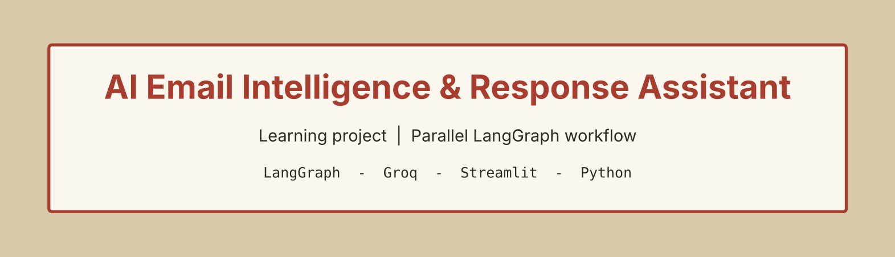
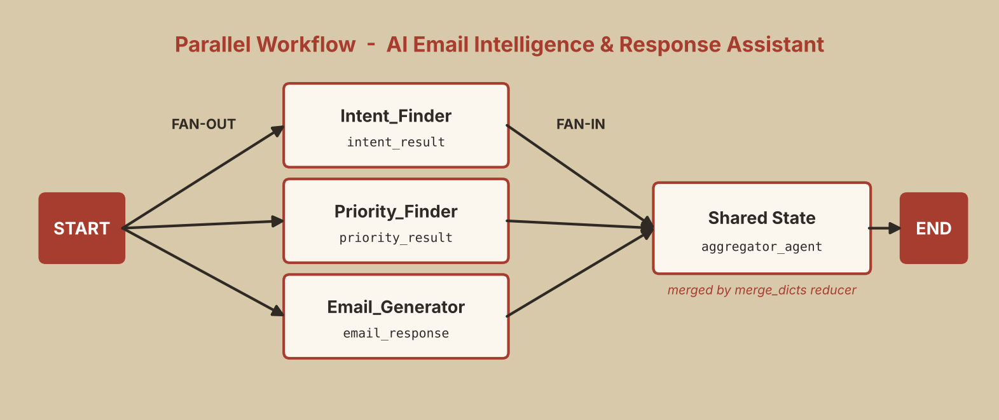

<p align="center">
  
</p>

<p align="center">
  
  
  
  
  
</p>

# 📧 AI Email Intelligence & Response Assistant

Paste any email and **three AI agents run at the same time**: one finds the intent, one rates the priority and one drafts a reply.

> 📚 **Learning project**
> This project was built **to learn parallel workflows and reducers in LangGraph**: fan-out, shared state and merging outputs from multiple nodes. It is a hands-on learning exercise, not a production system.

---

## 📑 Table of Contents

- [Features](#-features)
- [Workflow](#-workflow)
- [How it works](#-how-it-works)
- [Why a reducer is needed](#-why-a-reducer-is-needed)
- [Concepts practiced](#-concepts-practiced)
- [Sample input](#-sample-input)
- [UI design](#-ui-design)
- [Tech stack](#-tech-stack)
- [Project structure](#-project-structure)
- [Setup & run](#-setup--run)
- [What I learned](#-what-i-learned)
- [Future improvements](#-future-improvements)
- [Author](#-author)

---

## ✨ Features

- 🎯 **Intent Agent**: identifies the purpose of the email
- 🚦 **Priority Agent**: rates the email as **Critical, High, Medium or Low** with a 1 to 2 sentence reasoning
- 💬 **Response Agent**: writes a polite, concise reply draft (4 to 8 sentences) without inventing information
- All three agents work on the **same email at the same time**
- Simple **Streamlit UI** with a Torn Paper Edge design

---

## 🔄 Workflow

<p align="center">
  
</p>

The graph is **parallel**: the three agents do not depend on each other, so they all start together from `START` (fan-out) and write their results into one shared state key.

```text
START ─┬→ Intent_Finder ───┐
       ├→ Priority_Finder ─┼→ aggregator_agent (merged) → END
       └→ Email_Generator ─┘
```

---

## ⚙️ How it works

The state has the raw email and one dictionary where all agents put their results:

```python
class EmailAgent(TypedDict):
    raw_email: str
    aggregator_agent: Annotated[dict[str, str], merge_dicts]
```

| Agent (node) | Role | Writes into `aggregator_agent` |
|--------------|------|--------------------------------|
| `Intent_Finder` | Finds the intent behind the email | `intent_result` |
| `Priority_Finder` | Judges deadlines, urgency words, business impact and time sensitivity, then answers in a fixed `Priority: ... / Reasoning: ...` format | `priority_result` |
| `Email_Generator` | Writes only the reply, professional and friendly, without extra commentary | `email_response` |

The model runs with a **low temperature (0.25)** so the output stays consistent and professional.

---

## 🔀 Why a reducer is needed

When several parallel nodes write to the **same** state key, LangGraph needs to know how to combine the updates. Without a reducer, one update could replace another.

This project uses a small custom reducer:

```python
def merge_dicts(existing: dict, new: dict) -> dict:
    if existing is None:
        return new
    return {**existing, **new}
```

Each agent returns its own small dictionary, and `merge_dicts` merges them into one:

```python
{"intent_result": "...", "priority_result": "...", "email_response": "..."}
```

Because of the reducer, the graph is started with an empty dictionary for that key:

```python
app.invoke({"raw_email": email_text, "aggregator_agent": {}})
```

---

## 🧠 Concepts practiced

- **Fan-out** from `START` to multiple nodes, with LangGraph detecting parallel branches automatically
- **Reducers** using `Annotated` and a custom `merge_dicts` function
- Returning **partial state updates** from each node
- **Structured prompting** to force a fixed output format
- Choosing a **lower temperature** for professional, predictable text
- Adding a **Streamlit UI** on top of an existing graph without changing its logic
- Using `st.session_state` so results stay visible after the page reruns

---

## 📨 Sample input

```text
From: Sarah Mitchell
Subject: URGENT: Project Submission Deadline

Hi Alex,

The client presentation is scheduled for tomorrow morning, and we still need
the final project report.

Please review the latest figures, correct any errors, and send me the
completed report by 3:00 PM today.

This is our final deadline before the presentation. Please let me know
immediately if you face any issues.

Thanks,
Sarah
```

The app returns three cards: **🎯 Email Intent**, **🚦 Email Priority** and **💬 Suggested Email Response**.

---

## 🎨 UI design

The UI uses the **Torn Paper Edge** style, built with custom CSS inside Streamlit:

- Every card looks like a paper sheet with **torn top and bottom edges** made with a `clip-path` polygon
- A kraft-paper desk background (`#d8c9aa`) with warm paper cards
- Red headings and a button that also has a small torn edge

The page has a header card, an email input card and one card per agent output.

---

## 🛠️ Tech stack

| Area | Tools |
|------|-------|
| Language | Python |
| Workflow engine | LangGraph (`StateGraph`) |
| LLM | Groq via `langchain-groq` (`openai/gpt-oss-20b`, temperature 0.25) |
| UI | Streamlit + custom CSS |
| Config | `python-dotenv` |

---

## 📂 Project structure

```text
02_Parallel_Workflow/
├── AI_Email_Intelligence_and_Response_Assistant.py
├── README.md
├── requirements.txt
├── .env.example
├── .gitignore
└── assets/
    ├── banner.png
    └── workflow.png
```

---

## 🚀 Setup & run

**1. Create a virtual environment (recommended)**

```bash
python -m venv .venv
# Windows
.venv\Scripts\activate
# macOS / Linux
source .venv/bin/activate
```

**2. Install dependencies**

```bash
pip install -r requirements.txt
```

**3. Add your Groq API key**

Get a free key from the [Groq Console](https://console.groq.com/) and create a `.env` file in this folder (see `.env.example`):

```env
GROQ_API_KEY=your_groq_api_key_here
```

> 🔐 Never commit your `.env` file. It is already listed in `.gitignore`.

**4. Run the app**

```bash
streamlit run AI_Email_Intelligence_and_Response_Assistant.py
```

> The app is meant to be run with Streamlit. The old terminal version is kept in the file as commented code.

---

## 🎓 What I learned

- The difference between **sequential and parallel** workflows, and when to use each
- Why **reducers** are required when parallel nodes update the same state key
- How to write **role-based and format-controlled prompts**
- How to give an existing script a clean **UI without touching its core code**
- How custom CSS can make a Streamlit app feel designed instead of default

---

## 🔭 Future improvements

- [ ] Add a final node that combines all three outputs into one summary report
- [ ] Let the user choose the reply tone (formal, friendly, short)
- [ ] Support multiple emails or an email thread
- [ ] Parse the priority into a colour-coded badge in the UI
- [ ] Add error handling for API failures and rate limits
- [ ] Deploy with Streamlit Community Cloud or Docker

---

## 👤 Author

**Rohit Jha**

[](https://github.com/Rohit-coder-py)
[](https://linkedin.com/in/rohit-jha-ai)

⭐ If you found this useful, consider starring the repo.
